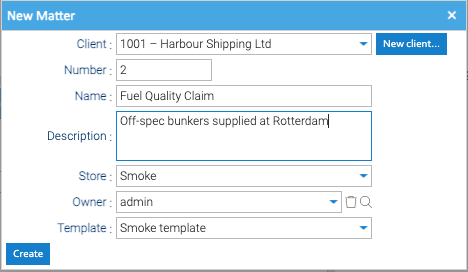

Every matter belongs to a client, and only admins create them. A matter **is** its workspace: one folder in a
Store, copied from a template. Your install can call matters something else, such as projects: see the matter label
in [Healdan Settings](../healdan-settings/).

## Clients

A client has a number, a positive whole number, and a name. Client numbers are unique.

- **Add a client** from [Healdan Settings](../healdan-settings/), or with **New client…** in the New Matter dialog.
  Healdan suggests the highest client number plus one.
- **Edit a client's name** in Healdan Settings.

## Creating a Matter

Right-click the Store the matter belongs in and choose **New Matter…**.

| Field | What to put |
|---|---|
| Client | the client, from the client list. **New client…** adds one |
| Number | the matter's number. Healdan suggests the next one; you can change it |
| Name, Description | the matter's name, and optionally what it's about |
| Store | the Store it goes in. The one you right-clicked is chosen |
| Owner | the user responsible for it |
| Template | the workspace template to copy, from the Templates Store |

When you click **Create**, Healdan:

1. copies the template into the Store as the matter's workspace, named like `1001.2 – Fuel Quality Claim`;
2. stamps the workspace with its client and matter, which pass down to everything in it;
3. gives the owner every permission on the workspace.

Then adjust the workspace's permissions on its **Security** tab, if the template's aren't right for this matter.

## Matter Numbers

How matters are numbered is one setting for the whole install, in [Healdan Settings](../healdan-settings/). Choose it
before clients start sharing matter numbers:

| | Per client (the default) | System-wide |
|---|---|---|
| Unique across | the client's matters, so 998.1 and 999.1 can both exist | all matters |
| Suggested number | the client's highest matter number plus one | the highest matter number in the system plus one |
| Searching for `1` in the Matters scope | lists every matter numbered 1, or opens it if there's only one | opens that matter |

Switching from system-wide to per client is always allowed. Switching from per client to system-wide is allowed only
if no two clients share a matter number; otherwise Healdan lists the clashes. Matter numbers can't be changed, so once
two clients share one, numbering stays per client.

## Editing and Deleting a Matter

- **Edit Matter…** on the workspace's right-click menu changes its name, description and owner. The workspace's name
  follows the matter's. Changing the owner gives the new owner every permission on the workspace and removes the old
  owner's; Healdan warns you first.
- **Deleting a matter:** delete its workspace folder as any folder. It goes to the trash, and restoring it brings the
  matter back. A matter's number is never reused, even after the trash is emptied.
