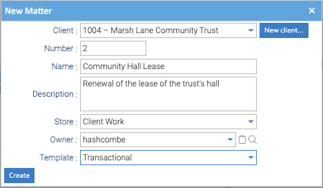

Every matter belongs to a client, and only admins create them. A matter **is** its workspace: one folder in a
Store, copied from a template. Your install can call matters something else, such as projects: see the matter label
in [Healdan Settings](../healdan-settings/). The Admin app's screens use that word too, as in **Projects** and **New
Project**.

Clients and matters are made and managed in [the Admin app](../the-admin-app/): **Clients** and **Matters** are under
**Firm** in its left pane.

## Clients

A client has a number, a whole number from 1, and a name. Client numbers are unique. A client's number never changes
once the client is made, only its name, and nothing deletes a client.

### The Clients List

**Clients**, at `/admin/clients`, lists every client, with how many there are beside the title, such as "5 Clients".

| Column | What it shows |
|---|---|
| Number | the client's number |
| Name | its name |
| Matters | how many matters it has, not counting those deleted |
| Documents | how many documents its matters hold, not counting shortcuts or the Trash |
| Last Activity | the day a document in one of its matters was last filed or saved |

- **Number or Name** keeps the clients whose number starts with what you type, or whose name holds it, in any case.
  The list follows once you pause typing.
- **Sorting:** click a column's heading to sort by it, and click it again to reverse the order. The list starts in
  number order. Clients that tie stay in number order, and one with nothing to sort by, such as no last activity,
  comes last either way.
- **Documents** and **Last Activity** come from the figures Healdan works out in the background for the Dashboard's
  [Usage](../the-admin-app/#usage), when the server starts and then 15 minutes after the last time. A line above the
  list says when, as in "Documents and Last Activity as of" and a time. Until the first time after a start they're
  blank, and the line says they haven't been worked out yet. A matter made since the last time adds nothing to its
  client's until the next.
- The list shows 100 clients, and the next 100 as you scroll down to them.
- The page's address keeps what you typed and the order, so a reload or a copied link shows the same list, and Back
  from a client's page comes back to it.
- Select a client, with a click or Enter, to open its page.

With no client yet it says "No client has been made yet.", and with none that matches, "No client matches the
filter."

### A Client's Page

- **Clients**, above the title, goes back to the list.
- **The title** is the client's number and name, such as "1001 – Saltmarsh Shipping Ltd", with **Rename** and **New
  Matter** beside it. **New Matter** here starts with the client chosen, so you begin with the matter's name.
- **Number**, **Matters**, **Documents** and **Last Activity**. Documents and Last Activity say "Not worked out yet"
  until the figures have been worked out since the server started, and Last Activity says "None" for a client with
  nothing filed.
- **Its matters,** as the [Matters list](#the-matters-list) shows them, without the Client column, and sorted the same
  way. Select one to open [its page](#a-matters-page). With none, it says "No matter has been made for this client
  yet."

An address that names no client says "Client Not Found", with **Go to Clients**.

The page and the list ask Healdan again each time you come back to their window, so a change another administrator
made shows without a reload.

### New Client

**New Client**, at the end of the Clients list's title, asks for:

- **Number:** Healdan fills in the highest client number plus one, or 1 for the first client, and you can type over
  it. The dialog reminds you that it can't be changed once the client is made. The suggestion reserves nothing, so
  if another administrator makes a client with that number first, yours is refused.
- **Name:** at most 255 characters.

New Client says what Healdan would refuse before you press **Create Client**, which stays greyed out until it's put
right:

| It says | When |
|---|---|
| "The number has to be a whole number, 1 or more." | the number is anything else |
| "Client number 1001 is already used, by Saltmarsh Shipping Ltd." | a client has that number already |
| "That is too long." | the name is over 255 characters |

Anything Healdan still refuses when you press it, such as a number another administrator took a moment before, shows
in the dialog in Healdan's own words. While the client is being made, **Cancel** is greyed out and Esc does nothing,
so you never back out of a client that's then made: once it's made, Healdan says "Created" with its number and name,
and its page opens. If it was refused, the dialog stays, saying why.

### Renaming a Client

**Rename**, on the client's page, changes its name and nothing else. The dialog shows the number as text ("Its number,
1001, can't be changed."), and **Rename** stays greyed out until the name differs from the one it has. The client's
matters keep their folders' names, which are made of their numbers and their own names.

### Clients in the Classic Interface

The client list on the Classic Interface's [Healdan Settings](../healdan-settings/), with **Add client** and **Edit**,
still works, and so does **New client…** in its New Matter dialog. Healdan records every client made and every rename,
whichever screen it's made from, with who made it and when.

## Matters

### The Matters List

**Matters**, at `/admin/matters`, lists every matter that isn't deleted: the one place that does, as the User app
lists no Store's matters. Beside the title is how many there are, such as "8 Matters".

| Column | What it shows |
|---|---|
| Matter | its number, with its client's, such as 1001.1 |
| Name | its own name |
| Client | its client's name |
| Store | the Store it's in |
| Owner | who owns it. Blank once that person's account has been deleted |
| Template | the workspace template it was made from. Blank once that template has been deleted |
| Documents | how many documents it holds, not counting shortcuts or the Trash |
| Size | the size of those documents' files, the current version of each |
| Last Activity | the day one of its documents was last filed or saved |

The filters above the list all apply together:

- **Number or Name** keeps the matters whose number, such as `1001.1`, starts with what you type, or whose own name
  or client's name holds it, in any case.
- **Client:** type a client's number or part of its name, and choose the client.
- **Store:** a menu of the Stores, **All Stores** to begin with.
- **Owner:** type part of a person's name or username, and choose them. People whose accounts are disabled are
  offered too, with **Disabled** beside their username, as their matters stay theirs.
- **Clear Filters,** which shows while a filter is set, takes them all off and keeps the order.

The list sorts, pages, keeps its address and asks again when you come back to it as the Clients list does: it starts
in number order, by client and then by matter. Documents, Size and Last Activity come from the same figures, and the
line above the list says when they were worked out, as in "Documents, Size and Last Activity as of" and a time. A
matter made since the last time shows 0 for Documents and Size, and no Last Activity, until the next. With no matter
yet it says "No matter has been made yet.", and with none that matches, "No matter matches the filters."

Select a matter, with a click or Enter, to open [its page](#a-matters-page).

### Creating a Matter

**New Matter**, at the end of the Matters list's title or on a client's page, opens New Matter. Its fields are on the
left, and **It Will Contain**, on the right, shows the matter's own folder named as it will be, such as "1004.2 –
Community Hall Lease", with the chosen template's folders and search folders under it. The template menu and It Will
Contain ask Healdan again when you come back to the window, so a template changed meanwhile shows as it is now.

| Field | What to put |
|---|---|
| Client | type the client's number or part of its name, and choose it. **New Client…** beside it makes one, starting with what you typed as its name, and puts it in the form |
| Number | the matter's number. Healdan fills in the client's next free number, and says which it is under the field. You can type over it. Choosing another client takes that client's next number. See [Matter Numbers](#matter-numbers) |
| Store | the Store it goes in, from a menu. **New Store…** beside it makes one and chooses it: see [Stores](../stores/#creating-a-store) |
| Name, Description | the matter's name, and optionally what it's about |
| Owner | the person responsible for it: type part of their name or username, and choose them. Only people who can sign in are offered |
| Template | the workspace template to copy, from a menu. With none yet, New Matter says one is needed first: see [Workspace Templates](../workspace-templates/) |

#### Problems Before You Create It

New Matter checks the form as you fill it in, once you pause typing, with the rules **Create Matter** keeps, so what
Healdan would refuse is said first, in its own words:

- **Beside the field it's about:** a client, Store, template or owner that no longer exists; a number below 1, or one
  a matter has already, a deleted matter included, as a number is never used again; a name with `/`, `\` or markup,
  or too long with the matter's number before it; a description over 4,000 characters; and an owner whose account is
  disabled.
- **Under the form:** a folder of the template that grants a group more than the folder it's in does, which a
  matter's folders can't (see [Permissions](../permissions/#folders-narrow-never-widen)); and a group the template
  would let into the matter, or the owner, who can't read the Store, as in "Everyone can't read the Store Regional
  Office."

**Create Matter** stays greyed out until every field but Description is filled in, the check has answered for the
form as it is, and it found nothing.

#### Letting a Group Read the Store

A group, or an owner, who can't read the Store has a button that names them, such as **Let Everyone Read the
Store**, with "Or choose another Store." beside it. The button lets them see the Store, keeping everyone who could
see it already, then checks the form again, and Healdan says so: "Everyone can now see Regional Office." If Healdan
refuses, the reason shows under the problem. The buttons are greyed out until the check has answered for the form as
it is, so a button never acts on a Store the form no longer names, and while one is on its way the others wait.

#### When You Create It

When you press **Create Matter**, Healdan does all of this, or none of it:

1. copies the template into the Store as the matter's own folder, named like `1004.2 – Community Hall Lease`, with its
   folders, their permissions and properties, and its search folders;
2. stamps every folder with the matter's client and matter, which pass down to everything filed in it;
3. gives the owner Full Access to the matter's folder.

While it's being made, **Cancel** is greyed out and Esc does nothing. Once it's made, Healdan says "Created" with the
matter's number and name, the dialog closes and [the matter's page](#a-matters-page) opens. Anything Healdan still
refuses, such as a number another administrator took a moment before, shows above the buttons in Healdan's own words.
Healdan records the new matter, with every field it set and who made it.

If the template's folders or permissions aren't right for this matter, change them on its page's
[Workspace tab](#the-workspace-tab).

#### New Matter in the Classic Interface

Right-click a Store in the Classic Interface's folder tree and choose **New Matter…** to make a matter there. It has
the same fields, the Store you right-clicked chosen, and Healdan applies the same rules when you click **Create**.

### A Matter's Page

A matter's page, at `/admin/matters/` and the matter's id, opens when you select the matter in the Matters list or on
its client's page, once New Matter has made it, and from **Manage in Admin** on the matter's menu in the User app (see
[Getting Around](../../user/getting-started/getting-around/#right-click-menus)).

- **Matters**, above the title, goes back to the list.
- **The title** is the matter's number and name, such as "1001.1 Charter Dispute – MV Northern Star", with **Edit**,
  **Move to Another Store**, **Open in Healdan**, **Reindex** and **Delete** beside it.

<!-- P6 docs pass 2 -->

- **The line under it** names the client, the Store, the owner, the template, and the documents with their size, as in
  "Saltmarsh Shipping Ltd · Client Work · owner Tom Reeve · from template Litigation · 412 documents, 4.6 GB". It
  says "no owner" once the owner's account has been deleted, and leaves out the template when there's none, and the
  figures until they've been worked out.
- **Three tabs,** **Overview**, **Workspace** and **Activity**. The page's address keeps the tab, so a reload or a
  copied link opens the same one.

An address that names no matter, or a matter in the Trash, says "Matter Not Found", with **Go to Matters**. The page
asks Healdan again each time you come back to its window, as the lists do.

#### The Overview Tab

- **Description:** the matter's description, or "No description."
- **Facts:** **Client**, which opens the client's page, **Store**, **Owner**, **Template**, **Documents**, **Size**
  and **Last Activity**. The last three come from the same figures as the Matters list's, and say "Not worked out yet"
  until they've been worked out since the server started. **Owner** says "None: the owner's account has been deleted"
  once it has, **Template** says "None" for a matter made from no template or whose template has gone, and **Last
  Activity** says "None" for a matter with nothing filed.
- **Stuck or Failing:** how many of the matter's documents couldn't be indexed, so search won't find their text, and
  how many of their previews were given up on, counted when the page asks. With neither, it says "Nothing in this
  matter is stuck or failing." See [Search and Indexing](../system/search-and-indexing/) and
  [Office Previews](../office-previews/).

#### The Workspace Tab

The **Workspace** tab is the matter's workspace in the [Workspace Editor](../top-level-folders/#the-workspace-editor):
its folders and search folders, who can use each folder, the values each sets, and each search folder's rule. Healdan's
permission rules check each change you save to a matter's workspace: see
[Who Can Use This Folder](../permissions/#who-can-use-this-folder). What you were changing there is kept while you
look at the Overview, and leaving the page over a change that isn't saved asks first (see
[Unsaved Changes](../top-level-folders/#unsaved-changes)).

#### The Activity Tab

The **Activity** tab is the [Audit Trail](../monitoring/audit-trail/) for the matter alone: what was done to the
documents and folders in its workspace, and the changes the administration record holds for the matter and its
folders, as [A Matter's Rows](../monitoring/audit-trail/#a-matters-rows) says, newest first. Its **Kind** tick boxes
offer **Document**, **Folder** and **Administration**; **From Date** and **To Date** keep the rows of some days;
and **Refresh** asks for the list again. Moving to it keeps what you were changing on the Workspace tab, and asks nothing.
**Open in the Audit Trail** opens the Audit Trail with the matter, the kinds you ticked and the days, as its filters,
for the rest of its filters and **Export CSV**. On a large server the tab can say it has found nothing back to a date
before a quiet matter's rows come: see [Reading Further Back](../monitoring/audit-trail/#reading-further-back).

#### Edit

**Edit** changes the matter's name, description and owner, and nothing else: the dialog says its client, number and
template never change, and that **Move to Another Store** changes its Store. **Save** stays greyed out until something
has changed, and the dialog says first what Healdan would refuse:

| It says | When |
|---|---|
| "A name can't have / or \ in it." | the name has a slash or a backslash |
| "That is too long." | the name, with the matter's number and a dash before it, is too long for a folder's name |
| "A description can be 4,000 characters at most." | the description is longer |
| "Its owner's account has been deleted. Choose a new owner." | the owner's account has gone |

**Owner** offers only people who can sign in, and can't be left empty. A new name renames the matter's folder, as in
`1001.1 – New Name`. A new owner gets Full Access to the matter's folder, and the old owner's row is taken off it, and
off the folders below that narrow with it. Anything else Healdan refuses, such as markup in the name or a new owner who
can't read the Store, shows in the dialog in Healdan's own words. While the change is on its way, **Cancel** is greyed
out and Esc does nothing; once it's saved, Healdan says "Saved" with the matter's number and name. Healdan records the
fields that changed.

#### Move to Another Store

**Move to Another Store** offers the Stores in a menu, the one the matter is in marked "(Where It Is Now)", which says
"It's in that Store already." if you choose it. **Move** stays greyed out until you choose another. The matter keeps
its client, number and name, and its documents their properties. As the dialog says, its files follow to the new
Store's [storage backend](../storage-backends/) in the background, so until they have, a file may still be read from
the old one (see
[Choosing a Store's Backend](../storage-backends/choosing-a-stores-backend/#matters-moving-between-stores)).

Healdan refuses the move, and the dialog says why:

- when a folder in that Store already has the matter's folder's name, in any case, as the matter's folder is never
  renamed to fit;
- while a document in the matter is checked out, by anyone;
- when a group that can read the matter can't read the new Store (see
  [A Matter and Its Store](../permissions/#a-matter-and-its-store)).

Once it's moved, Healdan says "Moved" with the matter and its new Store, and records the Store before and after.

#### Delete

**Delete** asks first: "Move 1001.1 to the Trash?" It names what the matter holds, counted afresh, as in "1001.1 –
Charter Dispute goes to the Trash with everything in it: 8 folders and 412 documents.", and says that its number stays
taken and that an administrator can restore it from the Trash in Healdan. **Move to Trash** moves the matter's folder,
with everything in it, to your Trash in the User app, and the Matters list opens. Healdan says "Moved" with the
matter's number and name, linking to that Trash, and records the delete.

Healdan refuses while a document in the matter is checked out, by anyone, you included, or while the matter holds an
immutable document, and the dialog says so.

The matter is then gone from the Admin app's lists and pages, and its number is never used again. To bring it back,
restore it from your Trash in the User app (see [The Trash](../../user/documents/the-trash/)), and it comes back to its
Store as it was. [The Trash and Removed Items](../the-trash-and-removed-items/) says how administrators restore what
anyone deleted.

#### Open in Healdan

**Open in Healdan** opens the matter's folder in the User app, in the same window.

#### Reindex

**Reindex** opens the [Search Index](../system/search-and-indexing/#reindex) with its Reindex dialog open and the
matter chosen, showing how many of its documents it will try and about how long that will take. The reindex indexes
again every document in the matter's workspace, straight through, and search keeps finding them meanwhile. A
reindex of the matter, or of a folder in it, shows on its **Activity** tab.

<!-- P6 docs pass 2 -->

#### Matters in the Classic Interface

**Edit Matter…**, on the workspace's right-click menu in the Classic Interface's folder tree, still changes a matter's
name, description and owner, with the same rules, and Healdan records each edit as it does one made in the Admin app.
A matter's folder can still be deleted there too, as any folder: it goes to the Trash, and restoring it brings the
matter back.

## Matter Numbers

How matters are numbered is one setting for the whole install, in [Healdan Settings](../healdan-settings/). Choose it
before clients start sharing matter numbers:

| | Per client (the default) | System-wide |
|---|---|---|
| Unique across | the client's matters, so 998.1 and 999.1 can both exist | all matters |
| Suggested number | the client's highest matter number plus one | the highest matter number in the system plus one |
| Searching for `1` in the Matters scope | lists every matter numbered 1, or opens it if there's only one | opens that matter |

Switching from system-wide to per client is always allowed. Switching from per client to system-wide is allowed only
if no two clients share a matter number; otherwise Healdan lists the clashes. Matter numbers can't be changed, so once
two clients share one, numbering stays per client.
