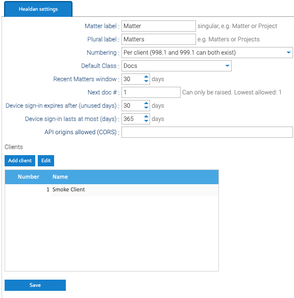

Healdan's own settings are under **Administration → Healdan → Settings**. Click **Save** after changing them.
Clients are saved from their own window, without Save.



| Setting | What it does |
|---|---|
| Matter label, Plural label | the word Healdan uses for a matter, such as Matter and Matters, or Project and Projects. It shows in the scope picker, the left pane's lists, the New Matter dialog and this panel, and renames the Matter property and the right-click menu items. Others see it after they next sign in. "Client" can't be changed |
| Numbering | per client or system-wide. See [Matter Numbers](../clients-and-matters/#matter-numbers) |
| Default Class | the Class a document gets when nothing above it sets one. "Docs" to begin with |
| Recent Matters window | how many days of a person's work their Recent Matters list covers. 30 to begin with |
| Next doc # | the number the next document gets. It can only be raised, for example to start at 1000 after a trial. The panel shows the lowest number allowed |
| Device sign-in expires after (unused days) | how long a device signed in through Healdan's [API](../../developer/api/) stays signed in without being used. 30 to begin with, and from 1 to 3650. A change applies to every device at once |
| Device sign-in lasts at most (days) | how long a device's sign-in lasts however often it's used. 365 to begin with, from 1 to 3650, and no less than the unused days. A change applies to sign-ins made after it |
| API origins allowed (CORS) | the addresses, other than Healdan's own, whose pages may call the API, such as `https://localhost:3000`, separated by commas: scheme, host and an optional port, with no path and no `*`. Empty to begin with, which is right unless an add-in is served from another address |
| Clients | the client list. **Add client** adds one, and **Edit** changes the selected client's name |

## The Class and Subclass Lists

The choices for Class and Subclass belong to the Healdan profile's attribute set:

1. Go to **Administration → Document metadata → Templates**, and open the **Attribute sets** tab.
2. Select **Healdan profile**, then the **Class** or **Subclass** attribute, and open its **Options**.
3. For each Subclass option, put the Class it belongs to in its **Category**. Healdan refuses a Subclass whose
   Category isn't the document's Class.

## Device Sign-Ins

A device that signs in through the API, such as an Office add-in, keeps a token instead of the password. The token
works only in the API: LogicalDOC's web services refuse it. The web page has no list of devices; the API lists a
person's own. To sign out every device a person has signed in on, change their password or disable them. Deleting a
person stops their devices at once too.

**A lost device.** Change the person's password, which signs out every device. Then have them delete any LogicalDOC
API keys they don't recognise: under the person icon in the top bar, **Security → API Keys**, right-click a key and
choose **Delete**. A device token can't make a key, but whoever had the device may have had the web page too, and a
key outlasts a password change. Disabling the person stops their keys as well as their devices.

## The Sign-In Throttle

Healdan limits wrong passwords on every way into it: the web page, the API, WebDAV, CMIS and LogicalDOC's web
services.

- **Five wrong passwords in a row for one username** block that username for 15 minutes, wherever the attempts
  come from.
- **Twenty failed sign-ins in a row from one network address** block that address for 15 minutes, for every
  username.
- **A block lifts by itself** 15 minutes after the last failed attempt. Attempts during a block aren't counted, so
  they don't make it longer. A successful sign-in with the password clears the count for its username and its
  address.
- **The account is never disabled,** so nobody has to unlock it.
- **People see** "Your username is temporarily blocked. Try after 15 minutes." on the sign-in page, or "Your IP is
  temporarily blocked. Try after 15 minutes." for a blocked address. The API answers `429 too-many-attempts`.
- **Alerts.** Each blocked attempt sends the users in `throttle.alert.recipients` (`admin` to begin with) a message
  in Healdan, and an email too if [outgoing email](../system/outgoing-email/) is set up.
- **`admin` and the server's own address.** LogicalDOC never blocks the `admin` account signing in from
  `127.0.0.1` or `::1`. Only a request from inside the app's container really comes from that address. But
  anything Tomcat trusts to forward addresses can claim it: the Docker host, which reaches the app through Docker's
  network, and the machines on your network when the app is published there or behind nginx or NPM. So the throttle
  doesn't protect `admin` from those. Give `admin` a long password that isn't used anywhere else. See
  [Reverse Proxy](../../install/reverse-proxy/#the-sign-in-throttle-behind-a-proxy).

Behind a reverse proxy, Healdan has to see each person's own address. See
[Reverse Proxy](../../install/reverse-proxy/#the-sign-in-throttle-behind-a-proxy), which also has the limitation
above in full.

### Changing the Limits

The throttle has no screen in Healdan. Its settings are in the configuration volume's `context.properties`. While
the app runs, a settings screen that saves rewrites the whole file from what the app read when it started, and your
change would be lost. So stop the app first, and start it again afterwards. From the folder with Healdan's
`compose.yaml`:

```bash
docker compose stop app
docker run --rm -it -v logicaldoc_logicaldoc-conf:/conf busybox vi /conf/context.properties
docker compose start app
```

In `vi`, find a setting with `/` and its name, press `i` to edit, then `Esc` and `:wq` to save and quit. The app
writes each setting as `name=value`. [Configuration](../../install/configuration/#settings-without-a-screen) says
more about editing the file.

| Setting | Healdan's value | What it does |
|---|---|---|
| `throttle.enabled` | `true` | turns the throttle on or off |
| `throttle.username.max` | `5` | wrong passwords in a row that block a username |
| `throttle.username.wait` | `15` | minutes a username stays blocked |
| `throttle.ip.max` | `20` | failed sign-ins in a row that block an address |
| `throttle.ip.wait` | `15` | minutes an address stays blocked |
| `throttle.username.disableuser` | `false` | `true` would also disable the account when its username is blocked, so it stays shut until an admin enables it. Leave it `false` |
| `throttle.alert.recipients` | `admin` | the usernames alerted, separated by commas without spaces |

LogicalDOC ships the throttle switched off. Healdan sets the first six once per install, so values you change
afterwards stay.
