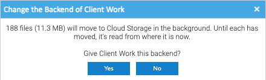
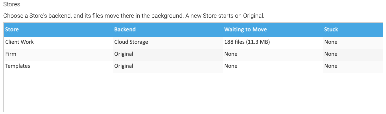

Each Store keeps its files on one backend, Original to begin with. To give a Store another, click its **Backend** in
the **Stores** list of the **Storage** tab, and choose one. The list offers the backends that aren't encrypted, and
the encrypted ones whose recovery key is confirmed.

Healdan asks first, saying how many files will move:

Choose **Yes**, and the Store keeps its files on the new backend from then on. Its files move there in the
background, and **Waiting to Move** shows how many are left, and their size:

Press **Refresh** to see the number fall. When a Store has no files to move, the question says so, and the change
takes effect at once.

## How Files Move

Healdan's **mover** moves files between backends in the background. For each file, it:

1. reads the file from where it is, decrypting it if that backend is encrypted;
2. writes it to the Store's backend, encrypting it if that one is, and checks the copy: an S3 service refuses an
   upload that doesn't match its checksum, and Healdan reads the uploaded size back; a copy in a folder is written to
   disk and its size checked;
3. switches the file over to the new copy, unless the file was saved again meanwhile, in which case it throws its
   copy away and moves the new one later;
4. holds the old copy for the holding period, rather than deleting it: see
   [Held Deletes and the Holding Period](../held-deletes/).

So a file is never removed from one place before its copy is safe in the other, and until it has moved, it's read
from where it is: documents open as usual throughout.

- **When:** at once, whenever something gives files a new place, and every 5 minutes besides.
- **In what order:** files waiting on the server to be uploaded first, then the rest, newest documents first.
- **How many at once:** **Parallel Transfers**, under **Settings**, 4 to begin with, from 1 to 16. More moves a
  large Store sooner, if the server's connection has room. A new value applies as soon as it's saved.
- **When one fails:** it's tried again later, and after ten failures it's left where it is: see
  [Waiting and Stuck Files](../waiting-and-stuck-files/). A backend that can't be reached pauses its moves instead:
  see [When a Backend Fails](../when-a-backend-fails/).

## Saves into a Store

- **On a local backend,** a save is written straight to its folder, encrypted if the backend is.
- **On an S3 backend,** a save lands on the server first, in staging, so it's as quick as a save into a local Store.
  The mover uploads it in the background, usually within seconds. Previews and thumbnails are made from the copy on
  the server, at the server's speed too.
- **Once it's uploaded,** the copy on the server becomes the file's entry in the [read cache](../the-read-cache/), so
  a file saved recently opens from the server.
- **Staging is in the repository volume,** so the nightly backup takes any file that hasn't been uploaded yet.
- **During an outage,** saves into a Store on S3 still work, and wait in staging until it's back.

## Matters Moving Between Stores

Moving a matter to another Store keeps the rules in [Stores](../../stores/), and the move itself is as quick as
before. Its files then follow it to the other Store's backend in the background, as above, and so do those of a
document moved into a matter in another Store, or of a folder restored from the trash into another Store. Until each
file has moved, it's read from where it is.

Every night at 03:17, server time, Healdan works out every file's Store again from the folder tree, puts right any
file whose record says another Store, and logs each one it fixes, so no file stays on the wrong backend.

## Giving a Store Back to Original

Choose **Original** for the Store. Its files come back to the server in the background, and their copies on the old
backend are held for the holding period, then deleted. A matter moved from a Store in the cloud to one on the server
does the same.
