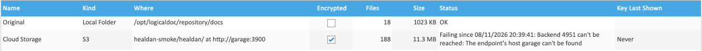

A backend is **failing** when Healdan can't use it. Its **Status**, on the **Storage** tab, says since when and why:

| Why | What the status says, in part | What to do |
|---|---|---|
| An S3 service, or the network to it, is down, or a folder can't be read | "can't be reached", or for a local folder "can't be read" | wait, or put the network right. Saves and cached files carry on meanwhile (below) |
| The bucket is gone | "bucket not found". A bucket deleted while the server runs shows first as "can't be reached", and as "bucket not found" after the next check | make the bucket again, or give the backend's Stores another backend |
| The S3 service refuses the access key | "check its access key and secret" | put them right with **Edit** |
| The S3 secret can't be read, as after Healdan's secret key was made again | "enter the secret again in Edit" | type the secret again with **Edit** |
| A folder's marker is missing, as when its share didn't mount | "is missing from its folder: the folder may not be mounted" | mount the share again |
| A bucket's marker is missing, as when the bucket was emptied | "has no marker" | check that the endpoint, bucket and prefix are the backend's own, and that nobody emptied it |
| The folder or bucket holds another backend's or another install's marker | "belongs to another backend or install" | give the backend its own place |
| The key file is missing, or isn't the backend's | "The key file of … is missing", "isn't the key it was made with" | restore the configuration volume, or [enter its recovery key](../encryption-and-recovery-keys/#putting-a-lost-key-file-back) |

A failing backend takes no saves and no moves, so nothing is written to a place that might be the wrong one. Saves
into a Store on S3 don't notice, as they land on the server first.

## How the Status Is Found

- **When the server starts,** Healdan checks every backend before it moves any file.
- **A backend that isn't OK** is checked again every minute until it passes. Then its moves carry on.
- **A backend that's OK isn't checked on a timer.** It shows Failing once a save, a read, a move or **Test** meets
  the problem, not before. So while a bucket is down, the tab can still say OK until someone needs a file from it.
- **Test** checks a backend at once.

## During an Outage of an S3 Backend

| What | What happens |
|---|---|
| Saves into its Stores | work as usual. They wait on the server, and go up once the backend is back |
| Files in the [read cache](../the-read-cache/), recent saves among them | open as usual |
| Other files | fail with a message that names the Store, such as "This file is in Client Work's cloud storage, which can't be reached right now." The web page's downloads and shared links show it, the Healdan Helper shows it, and the API answers `503 storage-unreachable` with it. A document's preview shows LogicalDOC's "not available" page instead |
| Searching, browsing and properties | work as usual: they never touch a backend |
| Moves to and from it | pause, without using up any tries, and carry on once it's back |
| Previews and thumbnails still to be made | wait for it, rather than being given up |

**The first read that meets an outage waits for the S3 service:** about 20 seconds when nothing answers at its
address, and up to two minutes when its server takes the connection and then stalls. From then on, while the outage
is known, reads of files that aren't in the read cache fail at once with the message, rather than each waiting. A
read refused more than five seconds after the outage was found starts a check of the backend at once, so a backend
that's back is found within seconds of someone asking for a file, and otherwise at the next minute's check.

A few of LogicalDOC's screens don't show the message during an outage: see the Install manual's
[Known Limitations](../../../install/known-limitations/).

## A Local Folder That Fails

A local backend, Original included, whose marker is missing refuses saves into its Stores, as when a disk is gone,
rather than writing files into an empty mount point where nobody would find them again. Its files can't be read
either, as they aren't there. Mount the share again: the next check, within a minute, finds the backend, or press
**Test**.

A folder that can't be read at all, as when a share stops answering, is an outage, as an S3 service's is: its status
says "can't be read", and saves into its Stores are refused. Once the outage is found, reads of its files fail at
once with a message that names the Store, as an S3 backend's does, but doesn't call it cloud storage, such as "This
file is in Firm's storage, which can't be reached right now." When the share answers again, the next check, within a
minute, finds the backend.

## The 24-Hour Alert

If a file has waited more than 24 hours to reach its Store's backend, or a backend has been failing for more than 24
hours, Healdan emails the members of the `admin` group that have an email address. The email says that storage needs
attention and sends them to the **Storage** tab. It names no file or backend.

- **It goes at most once a day,** and every day until the cause clears. Healdan looks every hour, so the first email
  comes within 25 hours.
- **A file's 24 hours start** when its place stopped matching its Store's backend: a Store given another backend an
  hour ago raises nothing, however old its files are.
- **It needs [outgoing email](../../system/outgoing-email/#when-email-counts-as-set-up).** Without it nothing is
  sent, and nothing takes its place in Healdan, but the tab still shows what's waiting and what's failing.
