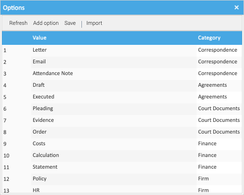

LogicalDOC keeps a set of properties as a *template*, which has nothing to do with a matter's
[workspace template](../../workspace-templates/), and the lists a property can choose from in an *attribute set*.
Healdan uses one of each, both called **Healdan profile**. They're under **Administration → Document metadata →
Templates**, on the **Templates** and **Attribute sets** tabs.

## The Healdan Profile

The **Healdan profile** template holds the properties every document and folder carries, which
[Properties](../../../user/working-with-matters/properties/) in the User Guide describes.

- **Healdan puts it on every document and folder in a matter** each time one is saved, so one given another
  template there gets the Healdan profile back at its next save.
- **The Healdan profile attribute set** holds the choices for Class (`docclass`) and Subclass (`docsubclass`), and
  the properties added to the profile ([Adding a Property](#adding-a-property)).
- **The email fields** (From, To, CC, Subject, Sent, Received and Message-ID) are filled from an `.eml` or `.msg`
  file when it's filed, and show on a document's **Ext. Properties** tab. Saving a new version reads only the
  Message-ID again; the others keep their values. See [Emails](../../../user/working-with-matters/emails/).
- **Healdan finds an email's copies through a table of its own,** which holds each document's Message-ID from when
  it's created, so editing the property afterwards doesn't change which messages count as copies. A new `.eml` or
  `.msg` whose file gives no Message-ID, such as a copy stored without its file, goes into that table with the
  Message-ID property it was created with, if it has one. Any other document never goes into it, whatever its
  property says.
- **Emails filed before Message-ID was added** get it in the background after the upgrade, starting a minute after
  Healdan starts. An email Healdan can't read stays without it. Their Message-ID can be searched for once they've been
  indexed again, which **Reschedule all for indexing** on [Search and Indexing](../search-and-indexing/#indexing-again)
  does.

## Changing the Class and Subclass Lists

1. On the **Attribute sets** tab, select **Healdan profile**, then the **docclass** or **docsubclass** attribute.
2. Click **Attribute options**, beside **Options** on the right of the attribute's form.
3. In the **Options** window, **Add option** asks for a **Value** and a **Category**. For a Subclass, the Category is
   the Class it belongs to, spelt exactly as the Class is.
4. Click **Save** in the **Options** window.

Healdan refuses a Subclass whose Category isn't the document's Class. A Category can't be changed in the list: to
move a Subclass to another Class, right-click it, choose **Delete**, which takes effect at once, and add it again.

Keep the Class that [Healdan Settings](../../healdan-settings/) names as the **Default Class** in the list.

## Adding a Property

A new property goes into the **Healdan profile** attribute set first, then into the template. To give documents a
court reference, for example:

1. On the **Attribute sets** tab, select **Healdan profile**.
2. In the form on the right, fill in the **Attribute name**, which is how LogicalDOC knows the property, in letters
   and digits only, such as `courtref`; the **Label**, which is what users see, such as "Court reference"; and the
   **Type**, such as **Text**.
3. Click **Save** under the form. The property joins the set's list, and a yellow bar appears above the tabs.
4. Click **Save** in the yellow bar.
5. On the **Templates** tab, select **Healdan profile**, and click **Add attributes** under its list of properties.
6. In the **Attributes Selector**, choose **Healdan profile** as the **Attribute set**, select the new property,
   click **Select**, then **Close**.
7. Click **Save** in the yellow bar.

The property then shows at the end of the **Ext. Properties** tab of every document and folder in a matter. It
passes down like Class: set it on a folder, and the folders and documents inside that have no value of their own
take the folder's. Every property you add passes down. Only Author, Typist, Comments, Legacy doc # and the email
details belong to one document.

## What to Leave Alone

- **The profile's name.** Don't rename the template or the attribute set, or delete the template. Healdan finds the
  profile by its name when it upgrades it, and every document and folder in a matter needs it.
- **The attribute set's Class and Subclass.** Healdan refuses to delete the attribute set the **Healdan profile**
  template takes **docclass** or **docsubclass** from, the **Healdan profile** set as Healdan ships, or to take that
  property out of it, to everyone, administrators included: either would empty the Class or Subclass list.
- **Healdan's own properties.** Don't delete them, rename them or change their type: Healdan's rules, its search and
  its API use them. The Matter property's label comes from the matter label in
  [Healdan Settings](../../healdan-settings/), which sets it again each time they're saved.

## Other Templates

To begin with, the Healdan profile is the only template. Others can be added with **Add template**, but they're of
no use inside a matter, where Healdan puts its profile back.
