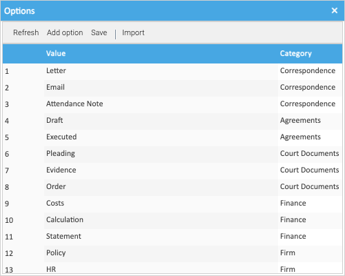

LogicalDOC keeps a set of properties as a *template*, which has nothing to do with a matter's
[workspace template](../../workspace-templates/), and the lists a property can choose from in an *attribute set*.
Healdan uses one of each, both called **Healdan profile**. They're under **Administration → Document metadata →
Templates**, on the **Templates** and **Attribute sets** tabs.

## The Healdan Profile

The **Healdan profile** template holds the properties every document and folder carries, which
[Properties](../../../user/working-with-matters/properties/) in the User Guide describes.

- **Healdan puts it on every document and folder in a matter** each time one is saved, so one given another
  template there gets the Healdan profile back at its next save.
- **The Healdan profile attribute set** holds the choices for Class (`docclass`) and Subclass (`docsubclass`).

## Changing the Class and Subclass Lists

1. On the **Attribute sets** tab, select **Healdan profile**, then the **docclass** or **docsubclass** attribute.
2. Click **Attribute options**, beside **Options** on the right of the attribute's form.
3. In the **Options** window, **Add option** asks for a **Value** and a **Category**. For a Subclass, the Category is
   the Class it belongs to, spelt exactly as the Class is.
4. Click **Save** in the **Options** window.

Healdan refuses a Subclass whose Category isn't the document's Class. A Category can't be changed in the list: to
move a Subclass to another Class, right-click it, choose **Delete**, which takes effect at once, and add it again.

Keep the Class that [Healdan Settings](../../healdan-settings/) names as the **Default Class** in the list.

## What Can't Be Changed Here

The Healdan profile template and attribute set can't be saved from this screen: LogicalDOC's form accepts a name of
letters and numbers only, and refuses theirs for its space. So the profile's properties can't be changed, and no
property can be added to it from the web page. The **Options** window saves on its own, so the Class and Subclass
lists can still be changed.

Don't rename them or delete them, either. Healdan finds the profile by its name when it upgrades it, and every
document and folder in a matter needs it.

## Other Templates

To begin with, the Healdan profile is the only template. Others can be added with **Add template**, but they're of
no use inside a matter, where Healdan puts its profile back.
