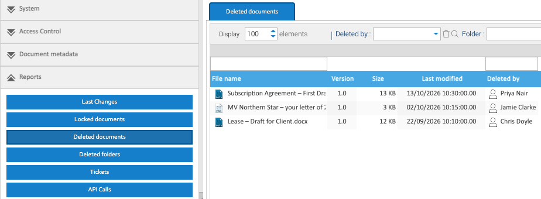

LogicalDOC's reports are under **Administration → Reports**. Only admins have them to begin with, and each can be
given to a group, as [Giving a Report to Others](#giving-a-report-to-others) says.

## The Reports

| Report | What it lists | What you can do from it |
|---|---|---|
| Last Changes | what people did to documents and folders: who, what, when and where. Filter it by person, dates, folder and kind of event | print it |
| Locked documents | nothing, in this release: a fault in LogicalDOC's code stops its list loading. It's meant to list the documents that are checked out or locked, and who by | – |
| Deleted documents | documents in the Trash, and who deleted them. Filter it by who deleted them and by folder | right-click one to **Restore** it, or **Permanently Delete** it |
| Deleted folders | folders in the Trash, and who deleted them | right-click one to restore it |
| Tickets | the download links people have made to share documents, with how often each was used | right-click one to disable it, set a password on it, or open its document |
| API Calls | the web service calls recorded, when recording is on. See [Recording Calls](../webdav-cmis-and-web-services/#recording-calls) | print it |

A restored document or folder has to go back into a matter's folder, as it does from the Trash.

## Giving a Report to Others

Each report opens from a menu, and each menu can be given to a group:

1. Go to **Administration → Access Control → Security**, and open the **Menus** tab.
2. Open **Administration**, then **Reports**, in the tree, and select the report.
3. Choose the group in **Add Group**, and click **Apply Rights**.
4. Do the same for **Administration** itself and for **Reports**.

Each menu is checked on its own, so the group needs all three. **Permanently Delete** on Deleted documents also
needs **Destroy documents**, which is under Deleted documents in the tree.

Without a deleted-items report, people see only what they deleted themselves, in their own Trash.
