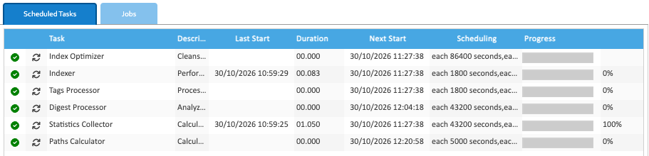

LogicalDOC's background work runs as tasks on schedules, listed under **Administration → System → Scheduled
Tasks**. Healdan adds no tasks of its own: its [Office previews](../../office-previews/) are made as files arrive.

## The Tasks

| Task | What it does | Runs, to begin with |
|---|---|---|
| Indexer | reads the text of new and changed documents into the search index, 500 at a time. A new document's words can be searched for once it has run | every 30 minutes |
| Index Optimizer | tidies the search index, so searches stay fast | once a day |
| Tags Processor | updates the lists of tags that the tag cloud and tag searches use | every 30 minutes |
| Digest Processor | works out a checksum for each file that hasn't one | every 12 hours |
| Statistics Collector | counts documents, pages and disk space for [System Information](../system-information/). It sends nothing outside your server | every 12 hours |
| Paths Calculator | fills in folder paths that are missing | every 5,000 seconds, about 83 minutes |

Each first runs between half an hour and an hour and a half after Healdan starts. **Next Start** shows when.

## Running a Task Now

Right-click the task and choose **Execute**. **Progress** shows how far it has got, and **Stop** stops it.

## Changing a Schedule

1. Select the task. Its **Scheduling** tab opens below the list.
2. Choose a **Policy**:
   - **Simple:** an **Initial delay** after Healdan starts, then a **Repeat interval**, both in seconds;
   - **Advanced:** a **Cron expression**, such as `0 0 2 * * ? *` for 2 a.m. every day. Replace the whole
     expression it offers: `* 10 * * * ? *` runs the task every second for a minute each hour.
3. **Max duration** stops a run that takes longer, in minutes. 0 means no limit.
4. Click **Save**, which shows once something has changed.

**Restore defaults** fills in a delay and an interval of 1,800 seconds and a max duration of 30 minutes, whatever
the task's own were to begin with.

## Turning a Task Off

Right-click the task and choose **Disable**, and **Enable** to turn it back on. Leave the Indexer on: without it,
new documents can't be found by their words.

## When the Server Is Busy

A running task pauses while the server's processors have been more than 80 % busy on average, and carries on when
they're less.

## The Jobs Tab

The **Jobs** tab lists one-off jobs. Nothing in Healdan makes any, so it stays empty.
