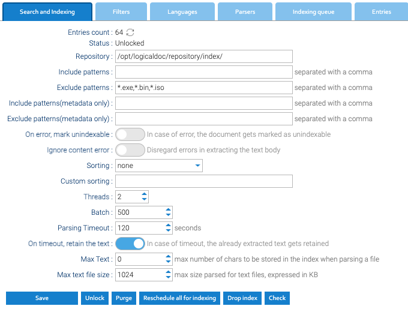

Full-text search reads from an index of the words in every document. **Search Index**, under **Search** in
[the Admin app](../../the-admin-app/)'s left pane, at `/admin/search-index`, shows how the index is doing: how many
documents are indexed, how many wait and how many couldn't be indexed, with those that couldn't and why, and the
reindexes, which it starts, follows and cancels. The index's settings stay in the Classic Interface, under
**Administration → Settings → Search and Indexing** (see [In the Classic Interface](#in-the-classic-interface)).

<!-- P6 docs pass 2 -->

## How a Document Gets Indexed

The [Indexer](../scheduled-tasks/) reads the text of new and changed documents into the index every 30 minutes to
begin with, so a document's words can be searched for after its first run since the document was filed.
[Finding New Documents Sooner](../scheduled-tasks/#finding-new-documents-sooner) says how to run it more often.

| Files | How their text is read |
|---|---|
| Word, Excel and PowerPoint (`.docx`, `.docm`, `.dotx`, `.xlsx`, `.xlsm`, `.pptx`, `.ppsx`) | by Healdan's own readers: a document's text, a workbook's cells, a presentation's slides |
| Emails (`.eml`, `.msg`) | by Healdan's own reader: From, To, CC, Subject, the date, the message's text and the attachments' names. What's in an attachment isn't indexed |
| PDFs, OpenDocument files, older Office formats, text, HTML and others | by LogicalDOC's readers |
| Other Office files: `.dotm`, `.xltx`, `.xltm`, `.pptm`, `.potx` and `.odg` drawings | converted to PDF with LibreOffice, then read |

A file whose text can't be read, such as a password-protected one, is indexed without it, so it's found only by its
properties.

The documents the Search Index counts are the live ones: not shortcuts, and not in the Trash. Each is in one of three
states, or in none of them while it's set to Skip:

- **Indexed:** its entry has been written to the index, and it hasn't been marked to be indexed again since.
- **Waiting:** it's marked to be indexed, its file or only its properties, for the Indexer to take at one of its runs.
  An archived document isn't counted, as the Indexer leaves it alone.
- **Couldn't Be Indexed:** it's marked to have its file indexed, isn't archived, and the last time it was tried, it
  couldn't be. The Indexer goes on trying it at each run until it's indexed or set to Skip.

<!-- P6 docs pass 2 -->

## The Search Index

At the top of the page are the three counts, **Indexed**, **Waiting** and **Couldn't Be Indexed**, then:

- **the index's health,** as the Dashboard's Search Index tile gives it: all is well while every document is indexed
  or waits to be, and it needs attention while one or more couldn't be indexed;
- **how many entries the index holds,** for documents and shortcuts alike, so it can differ from **Indexed**, and the
  size of the index's folder on the server's disk, each where it can be read;
- **the Indexer:** when it last ran and when it runs next, and **Run Indexer Now**.

<!-- P6 docs pass 2 -->

**Run Indexer Now** runs the Indexer at once, as **Run Now** on [Background Jobs](../../monitoring/background-jobs/)
does. The run takes the next documents waiting, as many as one run takes, those that couldn't be indexed among them.
It's greyed out, with the reason beside it, while the Indexer is running already or is disabled, and while the server
is set not to run scheduled tasks.

<!-- P6 docs pass 2 -->

### Reindexes Running

A reindex that's running, or waiting its turn, shows above the tabs: what it covers, such as "Matter 1001.1 Charter
Dispute", who started it and when, how far it has got, as in "212 of 412 documents", about how long it has left, and
**Cancel**. While the index can't be written, it says "Waiting for the index" (see [While It Runs](#while-it-runs)).
One that has been asked to stop says so, and has no **Cancel**. See [Reindex](#reindex).

<!-- P6 docs pass 2 -->

While a reindex waits or runs, the page asks again every 5 seconds for its progress, and every 30 seconds for the
counts and the open tab, while the page is showing. It asks again each time you come back to its window too. When a
reindex ends, the counts, the tabs and the left pane's count are asked for again at once.

### Couldn't Be Indexed

Each document that couldn't be indexed: its doc #, its file name, its matter, the reason, and when it was last tried,
the latest first.

<!-- P6 docs pass 2 -->

- **Try Again** indexes the document now, while you wait, as the Indexer would, so a large or slow file takes a while.
  The page says how it went. Indexed, it leaves the list. If it couldn't be indexed again, it stays, with the new
  reason, and the Indexer goes on trying it, unless **On error, mark unindexable** is on (see
  [The Settings](#the-settings)), which sets it to Skip, so it leaves the list. When the
  [storage backend](../../storage-backends/) that keeps its file can't be reached just then, Healdan says so, naming the
  Store, and the document stays as it was: try again once the backend is back.
- **Skip** sets the document not to be indexed, so the Indexer stops trying it, and it leaves the list. It's then
  counted in none of the three. Its entry in the index, if it has one, stays, and every reindex leaves it out from then
  on. To have it indexed again, choose **Mark indexable** for it on the Classic Interface's **Indexing History** tab
  (see [Indexing Again](#indexing-again)).

<!-- P6 docs pass 2 -->

A document with no doc #, filed before Healdan gave documents their numbers, is listed with **Try Again** and **Skip**
greyed out: reindex its folder to try it again.

<!-- P6 docs pass 2 -->

### Waiting

Each document waiting for the Indexer, those that couldn't be indexed left out, in the order they were filed in.
**Last Changed** is when the document last changed, which needn't be when it began to wait.

<!-- P6 docs pass 2 -->

### History

The reindexes, the newest first, those waiting and running and those that ended; then each time a document was indexed
or couldn't be, newest first, with the reason when it couldn't, and who did it and when. The events read back as the
[Audit Trail](../../monitoring/audit-trail/#reading-further-back) does, a stretch at a time, with **Show More**, so a
page can hold few rows, or none, while there's more to read. A document destroyed for good takes its rows with it.

<!-- P6 docs pass 2 -->

## Reindex

**Reindex…**, at the top of the Search Index, indexes again the documents you choose, straight through, on the server.
Choose what to reindex:

| Choice | What it covers |
|---|---|
| **Documents** | the documents whose doc #s you type or paste, up to 1,000. Each shows as found, with its file name and matter; as found but left out, with why (see below); or as not found |
| **Folder** | find the matter, then choose one of its folders: the documents in that folder and in every folder inside it, at every level |
| **Matter** | a search that starts from your Recent Matters and finds a matter by its number, its name or its client's name: the documents of the matter's whole workspace |
| **Store** | a plain list of the Stores: the documents of every matter in the Store |
| **Everything** | every document |

<!-- P6 docs pass 2 -->

A folder has no entry of its own in the index, so reindexing one means reindexing the documents in it. The dialog
shows how many documents the reindex will try, on its button, as in **Reindex 412 Documents**, and about how long it
will take once it runs: as long a time each as the documents took in the latest reindex that ran to its end having
tried 20 or more, or 1.75 seconds each until one has, not counting any reindex that runs before it.

<!-- P6 docs pass 2 -->

**What's left out,** and not counted: shortcuts, which the Indexer indexes again once the document each leads to is
done; documents set to Skip; archived documents, which the Indexer leaves alone too; and documents being changed at
that moment.

Healdan says before the button when it won't start one: "There's nothing here to reindex." for a choice with no
documents to try, and "This is already being reindexed." for a folder, matter, Store or Everything that a waiting or
running reindex covers already. Documents chosen by doc # are never refused as already being reindexed. More than 1,000
different doc #s at once are refused.

### While It Runs

- **Search keeps working.** Nothing is taken out of the index: each document's entry is replaced as it's done, so
  search finds it throughout. A document filed meanwhile is the Indexer's, as usual.
- **One reindex runs at a time,** across the server. One started while another waits or runs waits its turn, oldest
  first, and shows above the tabs as waiting.
- **It always reaches its end.** The documents it tries are fixed as it's started, and each is tried once, in the order
  they were filed in. A document deleted, in the Trash or destroyed by its turn, or set to Skip, archived or being
  changed at that moment, is skipped. A document moved or given a new version since is indexed as it is then.
- **A document whose file's storage can't be reached** at its turn is skipped too, keeping its entry and staying as it
  was, with no row on the **History** tab: a reindex once the [storage backend](../../storage-backends/) is back covers
  it.
- **A document it couldn't index** joins **Couldn't Be Indexed**, keeping the entry it had, and the Indexer goes on
  trying it at each run.
- **When the index can't be written,** the reindex waits and tries again, counting nothing meanwhile, and the
  Search Index says "Waiting for the index".
- **A restart** of the server lets the running reindex go on from where it was, and the waiting ones wait their turn
  as before.

<!-- P6 docs pass 2 -->

A reindex that has ended is on the **History** tab, saying how many documents it indexed, how many it couldn't, which
are on **Couldn't Be Indexed**, and how many it skipped. Together they're the documents it set out to try.

<!-- P6 docs pass 2 -->

### Cancel

**Cancel** stops a reindex. One waiting its turn is cancelled at once. One that's running finishes the documents it's
working on, then stops. Documents it hadn't reached keep the entries they have, and stay indexed, waiting or failed as
they were. A reindex that has ended can't be cancelled: "This reindex has ended."

<!-- P6 docs pass 2 -->

### Empty the Index First

**Empty the index first**, a tick box shown only under **Everything**, is for a damaged index. As the reindex's run
begins, not as it's started, so no other reindex is running then, it empties the index and marks every document to be
indexed. Search then misses documents until each is done again, and the Indexer takes any the reindex doesn't cover,
such as those filed meanwhile. A document set to Skip loses its entry, and stays set to Skip. Without the tick, nothing
is taken out of the index.

<!-- P6 docs pass 2 -->

### Reindex from Elsewhere

- **A matter's page,** in the Admin app, has **Reindex**, which opens the Search Index with Reindex open and the matter
  chosen (see [A Matter's Page](../../clients-and-matters/#reindex)).
- **A folder in the Workspace Editor,** on a matter's **Workspace** tab, has **Reindex** too, which opens it with the
  folder chosen (see [The Folder Chosen](../../top-level-folders/#the-folder-chosen)).
- **In the User app,** an administrator's right-click menu of a document, of several selected documents, of a folder
  and of a matter has **Reindex**. It asks first, naming what will be reindexed and how many documents, and its toast
  has **View Progress**, which opens the Search Index in a new tab, so you stay where you were. See
  [Right-Click Menus](../../../user/getting-started/getting-around/#right-click-menus) in the User Guide.

<!-- P6 docs pass 2 -->

The Reindex dialog is in the page's address, so a link can open it with its choice made, and Back closes it.

<!-- P6 docs pass 2 -->

## What Healdan Records

Healdan records, in the [Audit Trail](../../monitoring/audit-trail/), with who did it, when and from where:

- **a reindex started,** as "Started a reindex", named by what it covers, with its kind, how many documents it will
  try and whether it empties the index first;
- **a reindex cancelled,** as "Cancelled a reindex";
- **Try Again,** as "Tried to index a document again", named by the document's doc # and file name, as in
  `# 10412 Witness Statement.pdf`, with whether it was indexed or failed;
- **Skip,** as "Set a document not to be indexed", named the same way.

<!-- P6 docs pass 2 -->

**Run Indexer Now** is recorded as Background Jobs' **Run Now** is: "Asked a job to run". A reindex of a matter, or of
a folder in it, is on the matter's **Activity** tab too. A change that changes nothing isn't recorded, and nor is
anything that only reads, such as the count the Reindex dialog shows. **Try Again** that finds the file's storage
can't be reached records nothing, and adds no row to the **History** tab.

## In the Classic Interface

The Classic Interface's **Administration → Settings → Search and Indexing** keeps the index's settings, and its own
buttons and tabs still work beside the Admin app's Search Index.

### The Settings

| Setting | What it does |
|---|---|
| Include patterns, Exclude patterns | which files have their text indexed, by name, such as `*.iso`. `*.exe`, `*.bin` and `*.iso` are left out to begin with |
| Include patterns(metadata only), Exclude patterns(metadata only) | which files are indexed by their properties only, without their text |
| On error, mark unindexable | gives up on a file whose text can't be read, instead of trying again at each run |
| Ignore content error | indexes a file without its text when the text can't be read, instead of trying again at each run |
| Sorting | which documents the Indexer takes first, such as the most recent. **none** to begin with |
| Threads | how many documents are indexed at once. 2 to begin with |
| Batch | how many documents one run of the Indexer takes. 500 to begin with |
| Parsing Timeout | how long reading one file's text may take, in seconds. 120 to begin with |
| Max Text | the most characters of a document's text that are kept in the index. 0 means all |

Click **Save** after changing them.

### Indexing Again

The Admin app's [Reindex](#reindex) runs straight through, so a large reindex doesn't wait for the Indexer's runs, 500
documents every 30 minutes to begin with. These buttons mark documents for the Indexer instead:

- **Reschedule all for indexing** marks every indexed document to be indexed again, which the Indexer's next runs
  do. Use it after changing the patterns or the [languages](#the-other-tabs). It leaves documents marked
  unindexable as they are: select them on the **Indexing History** tab and choose **Mark indexable** from the
  right-click menu.
- **Drop index** empties the index and marks the same documents again. Until the Indexer has worked through them, a
  search finds less than it should.
- **Purge** removes deleted documents from the index, those in the Trash included.
- **Check** checks the index for damage, and **Unlock** frees an index left locked after a crash.

**Entries count** shows how many documents are in the index; click its icon to count them. The Search Index shows how
many entries the index holds too.

### The Other Tabs

| Tab | What it holds |
|---|---|
| Filters | the steps each word goes through before it's indexed |
| Languages | the languages whose word rules the index uses, so that "leases" finds "lease" |
| Parsers | which reader each kind of file goes to, Healdan's among them. A kind with no reader of its own can be sent to another kind's in **Aliases**: `tex` in `txt`'s Aliases would read `.tex` files as plain text |
| Indexing queue | the documents waiting to be indexed, which the Search Index's **Waiting** tab lists too |
| Entries | the index's entries, one per document |
| Indexing History | when each document was indexed, or failed to be, with the start of its text. The Search Index's **History** tab lists the same events, without the text |
| Search History | who searched for what, and when |
