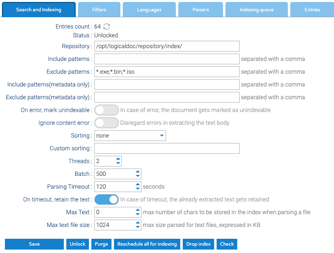

Full-text search reads from an index of the words in every document. Its settings are under **Administration →
Settings → Search and Indexing**.

## How a Document Gets Indexed

The [Indexer](../scheduled-tasks/) reads the text of new and changed documents into the index every 30 minutes, so
a document's words can be searched for after its first run since the document was filed.

| Files | How their text is read |
|---|---|
| Word, Excel and PowerPoint (`.docx`, `.docm`, `.dotx`, `.xlsx`, `.xlsm`, `.pptx`, `.ppsx`) | by Healdan's own readers: a document's text, a workbook's cells, a presentation's slides |
| Emails (`.eml`, `.msg`) | by Healdan's own reader: From, To, CC, Subject, the date, the message's text and the attachments' names. What's in an attachment isn't indexed |
| PDFs, OpenDocument files, older Office formats, text, HTML and others | by LogicalDOC's readers |
| Other Office files: `.dotm`, `.xltx`, `.xltm`, `.pptm`, `.potx` and `.odg` drawings | converted to PDF with LibreOffice, then read |

A file whose text can't be read, such as a password-protected one, is indexed without it, so it's found only by its
properties.

## The Settings

| Setting | What it does |
|---|---|
| Include patterns, Exclude patterns | which files have their text indexed, by name, such as `*.iso`. `*.exe`, `*.bin` and `*.iso` are left out to begin with |
| Include patterns(metadata only), Exclude patterns(metadata only) | which files are indexed by their properties only, without their text |
| On error, mark unindexable | gives up on a file whose text can't be read, instead of trying again at each run |
| Sorting | which documents the Indexer takes first, such as the most recent. **none** to begin with |
| Threads | how many documents are indexed at once. 2 to begin with |
| Batch | how many documents one run of the Indexer takes. 500 to begin with |
| Parsing Timeout | how long reading one file's text may take, in seconds. 120 to begin with |
| Max Text | the most characters of a document's text that are kept in the index. 0 means all |

Click **Save** after changing them.

## Indexing Again

- **Reschedule all for indexing** marks every document to be indexed again, which the Indexer's next runs do. Use
  it after changing the patterns or the [languages](#the-other-tabs).
- **Drop index** empties the index and marks every document again. Until the Indexer has worked through them, a
  search finds less than it should.
- **Purge** removes deleted documents from the index, those in the Trash included.
- **Check** checks the index for damage, and **Unlock** frees an index left locked after a crash.

**Entries count** shows how many documents are in the index; click its icon to count them.

## The Other Tabs

| Tab | What it holds |
|---|---|
| Filters | the steps each word goes through before it's indexed |
| Languages | the languages whose word rules the index uses, so that "leases" finds "lease" |
| Parsers | which reader each kind of file goes to, Healdan's among them. A kind with no reader of its own can be sent to another kind's in **Aliases**: `tex` in `txt`'s Aliases would read `.tex` files as plain text |
| Indexing queue | the documents waiting to be indexed |
| Entries | the index's entries, one per document |
| Indexing History | when each document was indexed, with the start of its text |
| Search History | who searched for what, and when |
