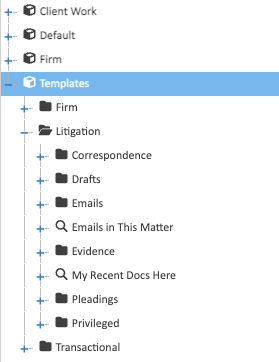

A **workspace template** is the folder a new matter is copied from, so matters of the same kind start the same way.
A template is an ordinary folder directly inside the **Templates** Store, which only admins can see. Templates are
made and built in [the Admin app](../the-admin-app/): **Workspace Templates** is under **Firm** in its left pane.

**Changing a template doesn't change matters already made from it.** Only matters created afterwards get the change,
as the template's page says.

## The Templates List

**Workspace Templates**, at `/admin/templates`, lists the templates by name:

| Column | What it shows |
|---|---|
| Name | the template's name |
| Folders | how many folders and search folders it holds |
| Matters Made From It | how many of the matters made from it aren't deleted |

The last column's heading takes your install's word for matters, as in **Projects Made From It**. Select a template to
open its page. With none yet, the list says "No workspace template has been made yet." and "Each matter is made from
a template, so make one before the first matter."

## New Template

**New Template**, beside the list's title, asks for:

- **Name:** the template's name, which no other template can have, in any case. New Template says so before
  **Create Template**, as in "There's already a template called Litigation.", and does the same for a `/` or `\` ("A
  name can't have / or \ in it.") and a name over 255 characters ("That is too long.").
- **Start From:** **Nothing (Empty)**, or a copy of another template, such as **A Copy of Litigation**. For a copy, the
  dialog says "A copy takes its folders, their permissions and values, and its search folders with their rules."

An empty template follows the Templates Store's permissions, as a folder made there does. A copy is made as New Matter
copies a template into a matter, all of it or none: every folder and search folder, at every level, hidden ones too,
with each folder's permissions and the values it sets, and each search folder's rule. A folder shortcut isn't copied.
The copy's own folder follows what the other's follows, or has permissions of its own as the other's has.
Afterwards the two have nothing to do with each other.

Once it's made, Healdan says "Created the template" with its name, and the template's page opens. Anything Healdan
refuses shows in the dialog, in Healdan's own words, such as a name another template took a moment before, and while
the template is being made, **Cancel** is greyed out and Esc does nothing. Healdan records the new template, with its
name and the template it copies.

## A Template's Page

- **Workspace Templates**, above the title, goes back to the list.
- **The title** is the template's name, with **Rename** and **Delete** beside it.
- **Folders** and **Matters Made From It**, as the list shows them, and a line that says changing the template
  doesn't change matters already made from it.
- **What New Matter Would Refuse,** when there's anything to say (see
  [below](#what-new-matter-would-refuse)).
- **The [Workspace Editor](../top-level-folders/#the-workspace-editor),** where you build the template: its folders
  and search folders, [who can use each folder](../permissions/#who-can-use-this-folder), the values each sets and
  each search folder's rule.

An address that names no template, or a template in the Trash, says "Template Not Found", with **Go to Workspace
Templates**.

### Renaming and Deleting a Template

- **Rename** opens Rename Template, which says first when another template has the name, in any case, and its
  **Rename** saves the new one. Changing only the case of its own name works. Matters already made from it are
  unchanged, and the Matters list shows the template's new name.
- **Delete** asks first, as in "Move the Template Litigation to the Trash?" It says the template's folders go with it,
  and that matters already made from it are unchanged and New Matter won't offer it any more. **Move to Trash** moves
  it, with its folders and search folders, to your Trash, and the list opens. The matters made from it then show no
  template in the Matters list.

Healdan records each rename, with the name before and after, and each delete.

A deleted template is in the Trash like anything else deleted, and so is a folder deleted from a template, but the
User app's Trash can't put either back in the Templates Store: its **Restore** says the folder it was deleted from is
gone, as it restores only into Stores. So their deletes have no **Undo**.

### What New Matter Would Refuse

Nothing checks a template's permissions as you change them, so a template can hold what New Matter would refuse in a
matter made from it. The template's page lists those problems as warnings under **What New Matter Would Refuse**, and
says "Saving still works: these are refused only when a matter is made from the template." They're asked for again
after each save in the Workspace Editor.

- **A folder that lets a group in more than the folder it's in does,** which a matter's folders can't (see
  [Folders Narrow, Never Widen](../permissions/#folders-narrow-never-widen)), once for each such folder or search
  folder, in the tree's order. That's one with permissions of its own, or one that still follows a folder further up:
  a folder made while the folder it's in followed that one goes on following it after the folder it's in gets
  permissions of its own.
- **A group that could read a matter made from the template, but can't read a Store,** once for each Store, every one
  but Default and Templates, and each such group, by the Store's name and then the group's (see
  [A Matter and Its Store](../permissions/#a-matter-and-its-store)). The matter's owner isn't known yet, so New Matter
  checks the owner when you choose one.

A folder's own problems also show beside its **Save** in the Workspace Editor, under "A new matter made from this
template would refuse this:". Put them right before making matters from the template; otherwise New Matter says the
same before **Create Matter**.

## Building a Template

Build a template in the Workspace Editor, with:

- **folders and subfolders**, such as Correspondence, Drafts and Emails;
- **permissions** on each folder, naming groups such as Everyone. A folder can be more restricted than the one
  above it, never less, such as a Privileged folder only partners can read;
- **properties** set on folders, such as an Invoices folder that sets Class to Financial;
- **search folders**, such as My Recent Docs Here. See
  [Search Folders](../../user/finding-documents/search-folders/).

Templates hold no documents.

## What a New Matter Gets

Creating a matter copies the template's folder tree, each folder's permissions, the properties set on each folder,
and its search folders with their rules, and stamps every folder with the matter's client and matter (see
[Creating a Matter](../clients-and-matters/#when-you-create-it)).

## An Example

| Folder | Permissions |
|---|---|
| *(the workspace)* | Everyone: read. IT: read and modify |
| Documents | the same as the workspace |
| Secured Documents | its own: IT only |
| Emails | its own: IT only |
| Recent Work | a search folder: documents anyone changed in the last 30 days |
| My Recent Work | a search folder: documents you changed in the last 30 days |

## Templates in the Classic Interface

In the Classic Interface's folder tree, the Templates Store shows the templates, and a template can still be built
there with its usual tools: right-click a folder for a new folder or **New search folder…**, and use a folder's
**Security** tab for its permissions.

