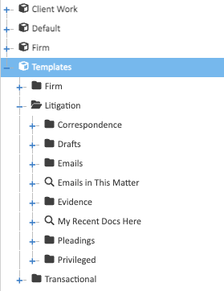

A **workspace template** is the folder a new matter is copied from, so matters of the same kind start the same way.
A template is an ordinary folder directly inside the **Templates** Store, which only admins can see.

## Building a Template

Create a folder in the Templates Store, then build it with the usual tools:

- **folders and subfolders**, such as Correspondence, Drafts and Emails;
- **permissions** on each folder, naming groups such as Everyone. A folder can be more restricted than the one
  above it, never less, such as a Privileged folder only partners can read;
- **properties** set on folders, such as an Invoices folder that sets Class to Financial;
- **search folders**, such as My Recent Docs Here. Right-click a folder and choose **New search folder…**. See
  [Search Folders](../../user/finding-documents/search-folders/).

Templates hold no documents.

## What a New Matter Gets

Creating a matter copies the template's folder tree, each folder's permissions, the properties set on each folder,
and its search folders with their rules.

**Changing a template doesn't change matters already made from it.** Only matters created afterwards get the
change.

## An Example

| Folder | Permissions |
|---|---|
| *(the workspace)* | Everyone: read. IT: read and modify |
| Documents | the same as the workspace |
| Secured Documents | its own: IT only |
| Emails | its own: IT only |
| Recent Work | a search folder: documents anyone changed in the last 30 days |
| My Recent Work | a search folder: documents you changed in the last 30 days |
