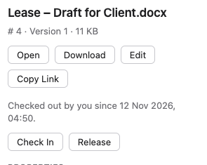
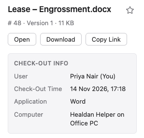

Checking a document out tells everyone you're editing it. While it's checked out to you, nobody else can save over
it: others can still read, preview and download it. Checking it in again saves your changes as its next snapshot or
version, and lets others edit it.

## In LibreOffice

With the [Healdan Helper](../../office/), you don't check out or in yourself:

- **Opening a document** you can edit checks it out to you, on the computer you open it on.
- **Each save** goes to Healdan, and the document stays checked out to you.
- **Closing it** checks it in.

See [Opening Documents](../../office/opening-documents/) and [Editing and Versions](../../office/editing-and-versions/).

### On Which Computer

A check-out from LibreOffice belongs to the computer it was made on, so two of your computers can't overwrite each
other's work. Opening the document on another of your computers warns you first, and **Edit Here Instead** moves the
check-out there. The first computer then keeps its copy, but can't save it to the document. See
[Checked Out to You on Another Computer](../../office/opening-documents/#checked-out-to-you-on-another-computer).

A check-out from the app or the Classic Interface belongs to no computer: it's yours, wherever you are.

## In the App

Select a document, and while someone has it checked out or locked, its details show a shaded box above the
**Properties** and **Versions** tabs, so it's there on both. **Check Out** is in the details, under that box, and in
the toolbar above the list.

### In the Lists

Every list of documents marks one that's held, at the end of its title: a pencil for a check-out, and a padlock for a
lock. That's a folder, search results, Recent and the result of a `#` search. The mark is an icon only, and stays put
when you point at the row, select it or move to it with the arrow keys. Point at the mark, and its tooltip says who has
the document, such as "Checked out by Alex Marsh", "Checked out by you" or "Locked by Alex Marsh". A screen reader reads
the same. The details say since when, and on which computer. A free document has no mark.

The marks are brought up to date with the rest of the page, each time you come back to it (see
[Keeping Up to Date](../../getting-started/getting-around/#keeping-up-to-date)): a document you open in Word shows the
pencil when you click back into the web page. Search results are the exception: their marks stay as they were until
you search again.

### Check-Out Info

While the document is checked out, the details show **Check-Out Info**, with a row for each thing Healdan knows:

| Row | What it says |
|---|---|
| **User** | Who has it checked out, with "(You)" after your own name |
| **Check-Out Time** | When they checked it out, or last saved to it from the computer that holds it |
| **Application** | The app it's open in, such as Excel or LibreOffice |
| **Computer** | The computer that holds it, by the name of its sign-in, such as "Healdan Helper on MacBook" |

**Application** and **Computer** show only for a check-out made on a computer, through the
[Healdan Helper](../../office/), and only to the person who has it checked out and to administrators, so an
administrator can tell someone which computer to check it in on. Everyone else sees **User** and **Check-Out Time**.
A check-out from the app or the Classic Interface belongs to no computer, so it has neither.

A locked document shows **Lock Info** instead, with **User** and **Lock Time**.

### Checking Out

Choose **Check Out**. Healdan checks the document out to you, and the details show its **Check-Out Info**, with you as
the **User**. It doesn't download anything: to edit the file, use **Open** (see
[Opening Documents](../../office/opening-documents/)), or **Download** it (see
[Downloading Documents](../downloading-documents/)).

You need permission to write the document. **Check Out** is greyed out while someone else has the document checked out
or locked, and for a document you can't write.

### Checking In

While the document is checked out to you from the app, **Check In** is in its details. Choose it, then choose the file
to upload. Healdan saves it as the document's next snapshot, such as 2.3, and checks the document in. The file is
saved under the document's own name, whatever the file you chose is called. To start the next version instead, such as
3.0, use the Classic Interface (see below). See [Versions](../versions/).

### Giving Up a Check-Out

To stop editing without saving anything, choose **Release**. The document stays as it was.

### When Someone Else Has It

The details' **Check-Out Info** names who has the document and since when. The app never takes a check-out over, and
offers no **Check In** or **Release** for it. It's released by the person who made it, on the computer it's checked
out on, or by an administrator in the Classic Interface, with **Unlock**.

That goes for your own check-out on a computer too. One you made by opening a document from the
[Healdan Helper](../../office/) belongs to that computer, which **Computer** names. Release it there, or in the
Classic Interface.

A locked document's **Lock Info** says who locked it, and when. A lock is taken off in the Classic Interface (see
[Locking a Document](../locking-a-document/)).

If the check-out changes under you, or a rule refuses it, the app says so in a few words, such as "It's checked out.",
and shows the document's hold as it now is.

## In the Classic Interface

### Checking Out

Right-click the document and choose **Checkout**. Healdan checks it out to you and downloads it, so you can edit it
on your computer. In the documents list, a checked-out document shows the edit icon; point at it to see who has it.

You need permission to write the document and to download it. A document someone else has checked out or locked
can't be checked out until they're done.

### Checking In

Right-click the document and choose **Checkin**.

1. Tick **New version (otherwise a snapshot)** to start the next version, such as 3.0 after 2.2. Leave it unticked
   for a snapshot, such as 2.3. See [Versions](../versions/).
2. Leave **Check file name** ticked to make sure you upload the right file: it must have the document's file name.
3. Type a **Comment** saying what changed, and choose the file to upload.
4. Choose **Submit**, check the properties, then choose **Checkin**.

Only you, or an administrator, can check in a document checked out to you.

### Giving Up a Check-Out

To stop editing without saving anything, right-click the document and choose **Unlock**. The document stays as it
was. Only you, or an administrator, can unlock a document checked out to you.

Checking in or unlocking in the Classic Interface works whichever computer holds the check-out. If you have the document open
in LibreOffice at the time, that copy can't be saved to the document any more: see
[When Things Go Wrong](../../office/when-things-go-wrong/#your-check-out-ended).

## Checking Out and Locking

Locking is different. A locked document can't be checked out by anyone until it's unlocked, and LibreOffice opens
it read-only, even for the person who locked it. See [Locking a Document](../locking-a-document/).
