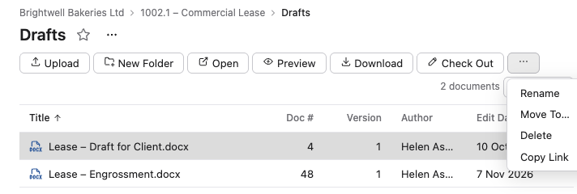

In the app you can rename, move and delete documents and folders, and make folders. A matter's own folder and a Store
are moved and deleted only by an administrator. You copy a document or a folder in the
[Classic Interface](../../the-classic-interface/). What you can't do, because of permissions or because a document is
locked or checked out, is refused with a message in the app, and greyed out in the Classic Interface.
Documents work in any list in the app: a folder, search results, the Recent lists and a document's own page
(`/app/doc/` and its doc #). Folders work in a folder's list, **Recent › Folders**, a **Folders** search and the
**My Matters** tree.

## Renaming a Document in the App

Select the document and press **F2**, or choose the **⋯** (More) button in the toolbar above the list, then **Rename**, or
right-click the document and choose **Rename** (see [Right-Click Menus](../../getting-started/getting-around/#right-click-menus)).
The title in its row becomes a field with the name, not its extension, selected.

- **Enter saves the name,** and so does clicking away from the field after you've changed it. **Esc** leaves the name as
  it was.
- **A document keeps its extension.** Type `Lease` and the document, a `.docx`, is `Lease.docx`. Type another extension,
  such as `Lease.pdf`, and Healdan says "The name has to end in .docx, as the document's does." beside the field, which stays
  open for you to mend it.
- **A name another document in the folder has gets a number,** as in the Classic Interface: `Lease.docx` there
  already, the document is `Lease(1).docx`.
- **You need the Rename permission,** and the document can't be locked or checked out by someone else, or checked out
  by you on a computer. The message says who has it and since when.
- **Only one document at a time.** With several selected, **Rename** is greyed out, and **F2** says "Select one
  document to rename it."

The rename is in the document's [history](../document-history/) and makes its next version.

## Moving Documents in the App

Select the documents, then choose the **⋯** (More) button, then **Move To…**, or right-click one of them and choose
**Move To…**. The same goes for folders (see [Moving a Folder in the App](#moving-a-folder-in-the-app)). A window opens that lists your **Recent Matters**, then your
**My Matters** other than those, so a matter in both is listed once, under Recent. Type in **Find a Matter** to search for another by its number or name.

1. Choose the matter. The window lists its folders.
2. Open the folders until you're in the one to move into. **Up One Level** goes back a folder, and **Back to Matters**
   to the matters. A folder with eight or more folders inside it has **Filter Folders**, which narrows them to those
   whose names hold what you type.
3. Choose **Move Here**. It's greyed out at the top of a matter, which holds no documents: "Open a folder inside the
   matter to move the documents into it."

The window never lists Stores, only matters and the folders inside them.

You can also **drag** the selected rows onto a folder in **My Matters** in the left pane. The folder lights up while you're
over it. Dragging a row that isn't selected moves only that one. A drag can't be done from the keyboard: use **Move To…**.

- **Each document moves on its own.** If Healdan refuses some, a window, "Some Documents Weren't Moved", says which, and
  why, and the others are moved all the same. The message says, for an email, "Already in this matter as # 10455" when the
  matter holds it already.
- **You need the Move permission** on each document and the Write permission on the folder you move it to.
- **It keeps its doc #,** and the move makes its next version. Within a matter it takes the properties of its new folder,
  except any set on the document itself. In another matter it also takes that matter's client and matter: see
  [Properties](../../working-with-matters/properties/).

Moving documents into the folder they're in does nothing: Healdan says "They're in that folder already." When only some are
there, the others move and only they are counted.

Dropping documents on a matter's top level, or on a search folder, says "Choose a folder inside the matter" and moves
nothing. See [Where Documents Can Go](#where-documents-can-go).

## Deleting in the App

Select documents or folders, or both, and press **Delete** (on a Mac, the delete key), or choose the **⋯** (More)
button, then **Delete**, or right-click one of them and choose **Delete**. On a folder in a list, on a folder in the
**My Matters** tree and on the open folder's **⋯** beside its name, the same choices are there. Healdan asks "Move
"Lease.pdf" to the Trash?", or "Move 4 items to the Trash?", and lists them. For a folder it says what it holds: "It
holds 3 folders and 11 documents." Choose **Move to Trash**, or **Cancel**, or press **Esc**.

Healdan then says "Moved "Lease.pdf" to the Trash", or "Moved 4 items to the Trash", with **Undo**, which puts it back
where it was. See [The Trash](../the-trash/), which also restores what you deleted, for as long as it stays there.

- **You need the Delete permission.** For a folder you need it on the folder and on everything inside it, including
  what you can't see. If you don't have it everywhere, Healdan says "It holds items you don't have permission to
  delete."
- **Locked or checked-out documents are refused with the reason:** release them first. A folder with a document checked
  out inside it, by anyone, you included, isn't deleted: Healdan says "Documents in it are checked out:", lists the
  ones you can read and says "They can be deleted once they're checked in or released."
- **A folder with an immutable document inside** can't be deleted: "It holds an immutable document, which can't be
  deleted."
- **Only administrators delete the folders at the top of a matter's workspace,** such as Correspondence and Drafts:
  **Delete** is greyed out there for anyone else, and the **Delete** key says "Only administrators can delete a
  matter's top-level folders." A matter's own folder isn't deleted in the app at all: "A matter's own folder is deleted
  by an administrator, with Delete on the matter's page in the Admin app."
- **Several at once,** documents and folders together, each is deleted on its own. A window, "Some Items Weren't Moved
  to the Trash", says which weren't and why, and the others are deleted all the same.
- **Deleting the folder that's open** takes you to its parent.

## Moving a Folder in the App

A folder moves the ways documents do, and a selection can hold folders and documents together: each is moved on its
own, with what's refused said per item.

- **Move To…** on the folder's right-click menu, in the **⋯** (More) menu, in the **My Matters** tree's **⋯**, on the
  open folder's **⋯** beside its name. The window is the one for documents, titled "Move "Old Drafts"" for one folder,
  or "Move 4 Items".
- **Dragging** the folder's row, or a folder in the **My Matters** tree, onto a folder in the tree. The folder you're
  over lights up.

In the window, a choice Healdan won't allow is greyed out with its reason:

- **"The folder itself,"** the folder you're moving, and what's in it.
- **"Already there,"** where it is already.
- **"Administrators only,"** the top of a matter, for anyone but an administrator.

A search folder is never listed. Healdan won't move a folder into a Store, a search folder or its own tree.

With folders and documents selected together, **Move Here** is greyed out only where none of them can go. At the top of
a matter, an administrator's folders move there, and "Some Items Weren't Moved" says the documents stayed, as a drag
does.

- **You need the Move permission** on the folder and on everything inside it, including what you can't see, and the
  Add permission on the folder you move it to. Without them Healdan says "You don't have permission to move this
  folder.", "It holds items you don't have permission to move." or, for the folder you move it to, "You don't have
  permission to add folders there."
- **A folder can't move while a document in it is checked out.** Healdan says "Documents in it are checked out:",
  lists the ones you can read and says "It can be moved once they're checked in or released."
- **Only administrators move the folders at the top of a matter's workspace,** or move a folder to the top of one:
  **Move To…** is greyed out there for anyone else, and Healdan says "Only administrators can move a matter's
  top-level folders." or, for a folder dropped on a matter in **My Matters**, "Only administrators can move folders
  into a matter's top level." A matter's own folder isn't moved in the app at all: "A matter's own folder is moved by
  an administrator, with Move to Another Store on the matter's page in the Admin app."
- **A folder can't go where another folder has its name.**
- **Healdan asks before a folder leaves its matter.** "Move "Old Drafts" into 1003.2 – Licence Review?", it says, with
  "Its 11 documents will take 1003.2's client and matter, and the properties its template sets." Choose **Move**, or
  **Cancel** to keep it where it is. A move within a matter goes at once.

Healdan says "Moved "Old Drafts" to Drafts", naming the folder it went to, when it's done. There's no **Undo** for a move: move it back. The
folder keeps its documents and their doc #s.

## Making a Folder in the App

Open a folder inside a matter and choose **New Folder** in the toolbar. Give it a name and choose **Create**. The new folder
takes its parent's properties and permissions, and you need the Add permission on the parent.

The button isn't there at the top of a matter, in a search folder or in a Store. Only administrators can add folders to the
top of a matter's workspace.

## Renaming a Folder in the App

Its name becomes a field, with all of it selected. **Enter** saves, and so does clicking away after you've changed it;
**Esc** leaves it as it was. There are four ways in:

- **In a list,** move to the folder's row with the arrow keys and press **F2**. That works in a folder, in a
  **Folders** search and in **Recent › Folders**.
- **In My Matters** in the left pane, point at the folder and choose its **⋯** button, then **Rename**, or move to
  it with the arrow keys and press **F2**.
- **The folder you have open:** choose the **⋯** button beside its name above the list, then **Rename**.
- **Right-click the folder,** in a list or in My Matters, and choose **Rename** (see
  [Right-Click Menus](../../getting-started/getting-around/#right-click-menus)).

Some renames aren't allowed, and the app says why:

- **You need the Rename permission** on the folder. Without it, **Rename** is greyed out and **F2** says "You don't
  have permission to rename this folder."
- **Only administrators rename the folders at the top of a matter,** such as Correspondence and Drafts, search
  folders included. For anyone else **Rename** is greyed out there, and **F2** says "Only administrators can rename a
  matter's top-level folders."
- **A matter's own folder isn't renamed here.** It takes the matter's name, which only an administrator changes, so
  **Rename** is greyed out on it, and **F2** says "A matter's own folder takes the matter's name: an administrator
  changes it with Edit on the matter's page in the Admin app."
- **Two folders side by side can't share a name.** Healdan says "There's already a folder called Drafts here." beside
  the field, which stays open for you to choose another. Changing only the case of the folder's own name, such as
  `drafts` to `Drafts`, works.
- **A name can't have** `/`, `\` or HTML tags in it, or characters that turn the text round. Emoji are fine.

The rename is in the folder's history. Its documents keep their doc #s and properties.

## In the Classic Interface

Right-click a document for its menu. **Cut**, **Copy**, **Rename** and **Delete** are there, with everything else you can
do to it. To act on several documents at once, select them all, then right-click one of them.

## Copying a Document

1. Right-click the document and choose **Copy**.
2. In the folder tree, right-click the folder to copy it into and choose **Paste**.
3. **Copy options** asks what the copy takes with it: **Copy links**, **Copy notes and annotations** and
   **Copy security**. All three are ticked to begin with. Choose **Ok**.

- **The copy is a new document,** with a doc # of its own. Its Date filed is when you pasted it, and its versions
  start again at 1.0.
- **It takes its client and matter from where you paste it,** and the folder's other properties too, except any that
  were set on the original document itself. See [Properties](../../working-with-matters/properties/).
- **Paste is greyed out** in a folder you can't add documents to.

## Moving a Document in the Classic Interface

1. Right-click the document and choose **Cut**.
2. Right-click the folder to move it to and choose **Paste**. **Copy options** appears here too, but a move ignores
   it: choose **Ok**.

- **It keeps its doc #,** and the move makes its next snapshot, such as 1.1 after 1.0. See [Versions](../versions/).
- **Within a matter,** it takes the properties of its new folder, except any set on the document itself.
- **To another matter,** it also takes that matter's client and matter. A document moved from 1002.2 to 1002.1 is in
  matter 1002.1 from then on, and its old matter no longer lists it.
- **Cut is greyed out** for a document that's locked or checked out, and unless you have the Move permission on it.

## Where Documents Can Go

A document can only be in a folder **inside** a matter's workspace, wherever it comes from. Healdan refuses a copy,
a move or a restore anywhere else, and says why:

- **at a Store's top level,** or in a Store you can't add to, Paste is greyed out;
- **at the top level of a matter's workspace:** "Documents can't be saved at the top level of a matter. Choose one
  of its folders.";
- **in a search folder:** "Search folders can't hold documents."

Nothing is copied or moved when Healdan refuses. See [Filing a Document](../../working-with-matters/filing-a-document/).

## Folders

Right-click a folder and choose **Copy** or **Move**, then choose a target folder in the window that opens. The
folder goes with everything in it. A folder can't go directly into a Store or inside a search folder. **Paste**, on a
folder's menu, is where documents you've copied or cut go.

Only administrators can add, rename, move or delete the folders at the top of a matter's workspace, such as
Correspondence and Drafts. Anyone else is told "Only administrators can add, rename, move or delete a matter's
top-level folders." The folders inside them follow their permissions as usual.

## Deleting in the Classic Interface

1. Right-click the document and choose **Delete**.
2. Healdan asks "Do you want to delete the selected elements?" Choose **Yes**.

For a folder, choose **Delete** on its own menu, and **Yes** to "Do you want to delete this folder?". The folder and
everything in it go.

- **Deleted things go to the trash,** where you can restore them. See [The Trash](../the-trash/).
- **You need the Delete permission.** Delete is greyed out for a document that's locked or checked out.
- **A matter itself,** its workspace, can only be deleted by an administrator.
