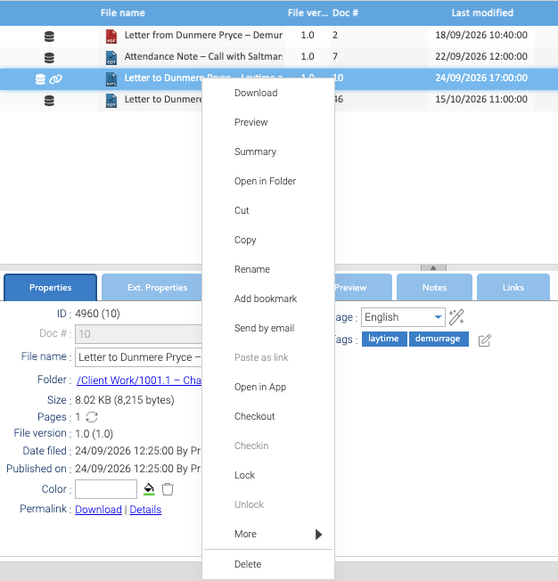

Right-click a document for its menu. **Cut**, **Copy** and **Delete** are there, with everything else you can do to
it. What you can't do to that document, because of its permissions or because it's locked or checked out, is greyed
out.

To act on several documents at once, select them all, then right-click one of them.

## Copying a Document

1. Right-click the document and choose **Copy**.
2. In the folder tree, right-click the folder to copy it into and choose **Paste**.
3. **Copy options** asks what the copy takes with it: **Copy links**, **Copy notes and annotations** and
   **Copy security**. All three are ticked to begin with. Choose **Ok**.

- **The copy is a new document,** with a doc # of its own. Its Date filed is when you pasted it, and its versions
  start again at 1.0.
- **It takes its client and matter from where you paste it,** and the folder's other properties too, except any that
  were set on the original document itself. See [Properties](../../working-with-matters/properties/).
- **Paste is greyed out** in a folder you can't add documents to.

## Moving a Document

1. Right-click the document and choose **Cut**.
2. Right-click the folder to move it to and choose **Paste**. **Copy options** appears here too, but a move ignores
   it: choose **Ok**.

- **It keeps its doc #,** and the move makes its next snapshot, such as 1.1 after 1.0. See [Versions](../versions/).
- **Within a matter,** it takes the properties of its new folder, except any set on the document itself.
- **To another matter,** it also takes that matter's client and matter. A document moved from 1002.2 to 1002.1 is in
  matter 1002.1 from then on, and its old matter no longer lists it.
- **Cut is greyed out** for a document that's locked or checked out, and unless you have the Move permission on it.

## Where Documents Can Go

A document can only be in a folder **inside** a matter's workspace, wherever it comes from. Healdan refuses a copy,
a move or a restore anywhere else, and says why:

- **at a Store's top level,** or in a Store you can't add to, Paste is greyed out;
- **at the top level of a matter's workspace:** "Documents can't be saved at the top level of a matter. Choose one
  of its folders.";
- **in a search folder:** "Search folders can't hold documents."

Nothing is copied or moved when Healdan refuses. See [Filing a Document](../../working-with-matters/filing-a-document/).

## Folders

Right-click a folder and choose **Copy** or **Move**, then choose a target folder in the window that opens. The
folder goes with everything in it. A folder can't go directly into a Store or inside a search folder. **Paste**, on a
folder's menu, is where documents you've copied or cut go.

Only administrators can add, rename, move or delete the folders at the top of a matter's workspace, such as
Correspondence and Drafts. Anyone else is told "Only administrators can add, rename, move or delete a matter's
top-level folders." The folders inside them follow their permissions as usual.

## Deleting

1. Right-click the document and choose **Delete**.
2. Healdan asks "Do you want to delete the selected elements?" Choose **Yes**.

For a folder, choose **Delete** on its own menu, and **Yes** to "Do you want to delete this folder?". The folder and
everything in it go.

- **Deleted things go to the trash,** where you can restore them. See [The Trash](../the-trash/).
- **You need the Delete permission.** Delete is greyed out for a document that's locked or checked out.
- **A matter itself,** its workspace, can only be deleted by an administrator.
