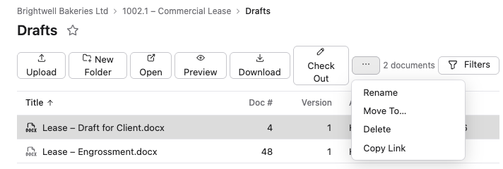

In the app you can rename, move and delete documents, and make folders. Copying a document, and moving, renaming or
deleting a folder, are in the [Classic Interface](../../the-classic-interface/). What you can't do to a document, because of
its permissions or because it's locked or checked out, is refused with a message in the app, and greyed out in the Classic Interface.
All of it works in any list of documents in the app: a folder, search results, the Recent lists and a document's own
page (`/app/doc/` and its doc #).

## Renaming a Document in the App

Select the document and press **F2**, or choose the **⋯** (More) button in the toolbar above the list, then **Rename**, or
right-click the document and choose **Rename** (see [Right-Click Menus](../../getting-started/getting-around/#right-click-menus)).
The title in its row becomes a field with the name, not its extension, selected.

- **Enter saves the name,** and so does clicking away from the field after you've changed it. **Esc** leaves the name as
  it was.
- **A document keeps its extension.** Type `Lease` and the document, a `.docx`, is `Lease.docx`. Type another extension,
  such as `Lease.pdf`, and Healdan says "The name has to end in .docx, as the document's does." beside the field, which stays
  open for you to mend it.
- **You need the Rename permission,** and the document can't be locked or checked out by someone else, or checked out
  by you on a computer. The message says who has it and since when.
- **Only one document at a time.** With several selected, **Rename** is greyed out, and **F2** says "Select one
  document to rename it."

The rename is in the document's [history](../document-history/) and makes its next version.

## Moving Documents in the App

Select the documents, then choose the **⋯** (More) button, then **Move To…**, or right-click one of them and choose
**Move To…**. A window opens that lists your **Recent Matters**, then your
**My Matters** other than those, so a matter in both is listed once, under Recent. Type in **Find a Matter** to search for another by its number or name.

1. Choose the matter. The window lists its folders.
2. Open the folders until you're in the one to move into. **Up One Level** goes back a folder, and **Back to Matters**
   to the matters.
3. Choose **Move Here**. It's greyed out at the top of a matter, which holds no documents: "Open a folder inside the
   matter to move the documents into it."

The window never lists Stores, only matters and the folders inside them.

You can also **drag** the selected rows onto a folder in **My Matters** in the left pane. The folder lights up while you're
over it. Dragging a row that isn't selected moves only that one. A drag can't be done from the keyboard: use **Move To…**.

- **Each document moves on its own.** If Healdan refuses some, a window, "Some Documents Weren't Moved", says which, and
  why, and the others are moved all the same. The message says, for an email, "Already in this matter as # 10455" when the
  matter holds it already.
- **You need the Move permission** on each document and the Write permission on the folder you move it to.
- **It keeps its doc #,** and the move makes its next version. Within a matter it takes the properties of its new folder,
  except any set on the document itself. In another matter it also takes that matter's client and matter: see
  [Properties](../../working-with-matters/properties/).

Moving documents into the folder they're in does nothing: Healdan says "They're in that folder already." When only some are
there, the others move and only they are counted.

Dropping documents on a matter's top level, or on a search folder, says "Choose a folder inside the matter" and moves
nothing. See [Where Documents Can Go](#where-documents-can-go).

## Deleting Documents in the App

Select them and press **Delete** (on a Mac, the delete key), or choose the **⋯** (More) button, then **Delete**, or
right-click one of them and choose **Delete**. Healdan asks "Move 2 documents to the Trash?" and lists each one's name.
Choose **Move to Trash**, or **Cancel**, or press **Esc**.

- **The Trash is in the Classic Interface,** where you can restore what you deleted: "The Trash is in the Classic
  Interface, where they can be restored." See [The Trash](../the-trash/).
- **You need the Delete permission.** A document that's locked, or checked out by anyone, you included, is refused with the
  reason: release it first. The others are deleted all the same.

## Making a Folder in the App

Open a folder inside a matter and choose **New Folder** in the toolbar. Give it a name and choose **Create**. The new folder
takes its parent's properties and permissions, and you need the Add permission on the parent.

The button isn't there at the top of a matter, in a search folder or in a Store. Only administrators can add folders to the
top of a matter's workspace.

## In the Classic Interface

Right-click a document for its menu. **Cut**, **Copy**, **Rename** and **Delete** are there, with everything else you can
do to it. To act on several documents at once, select them all, then right-click one of them.

## Copying a Document

1. Right-click the document and choose **Copy**.
2. In the folder tree, right-click the folder to copy it into and choose **Paste**.
3. **Copy options** asks what the copy takes with it: **Copy links**, **Copy notes and annotations** and
   **Copy security**. All three are ticked to begin with. Choose **Ok**.

- **The copy is a new document,** with a doc # of its own. Its Date filed is when you pasted it, and its versions
  start again at 1.0.
- **It takes its client and matter from where you paste it,** and the folder's other properties too, except any that
  were set on the original document itself. See [Properties](../../working-with-matters/properties/).
- **Paste is greyed out** in a folder you can't add documents to.

## Moving a Document in the Classic Interface

1. Right-click the document and choose **Cut**.
2. Right-click the folder to move it to and choose **Paste**. **Copy options** appears here too, but a move ignores
   it: choose **Ok**.

- **It keeps its doc #,** and the move makes its next snapshot, such as 1.1 after 1.0. See [Versions](../versions/).
- **Within a matter,** it takes the properties of its new folder, except any set on the document itself.
- **To another matter,** it also takes that matter's client and matter. A document moved from 1002.2 to 1002.1 is in
  matter 1002.1 from then on, and its old matter no longer lists it.
- **Cut is greyed out** for a document that's locked or checked out, and unless you have the Move permission on it.

## Where Documents Can Go

A document can only be in a folder **inside** a matter's workspace, wherever it comes from. Healdan refuses a copy,
a move or a restore anywhere else, and says why:

- **at a Store's top level,** or in a Store you can't add to, Paste is greyed out;
- **at the top level of a matter's workspace:** "Documents can't be saved at the top level of a matter. Choose one
  of its folders.";
- **in a search folder:** "Search folders can't hold documents."

Nothing is copied or moved when Healdan refuses. See [Filing a Document](../../working-with-matters/filing-a-document/).

## Folders

Right-click a folder and choose **Copy** or **Move**, then choose a target folder in the window that opens. The
folder goes with everything in it. A folder can't go directly into a Store or inside a search folder. **Paste**, on a
folder's menu, is where documents you've copied or cut go.

Only administrators can add, rename, move or delete the folders at the top of a matter's workspace, such as
Correspondence and Drafts. Anyone else is told "Only administrators can add, rename, move or delete a matter's
top-level folders." The folders inside them follow their permissions as usual.

## Deleting in the Classic Interface

1. Right-click the document and choose **Delete**.
2. Healdan asks "Do you want to delete the selected elements?" Choose **Yes**.

For a folder, choose **Delete** on its own menu, and **Yes** to "Do you want to delete this folder?". The folder and
everything in it go.

- **Deleted things go to the trash,** where you can restore them. See [The Trash](../the-trash/).
- **You need the Delete permission.** Delete is greyed out for a document that's locked or checked out.
- **A matter itself,** its workspace, can only be deleted by an administrator.
