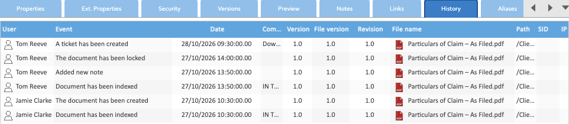

A document's history records who did what to it, and when: filing it, each check-in, moves, notes, locks and the
rest, newest first.

## Who Sees It

The **History** tab, among a document's details, is there for administrators, and for anyone their administrator
has given the History menu. If you don't see the tab and need it, ask your administrator.


**For administrators:** the menu is under **Administration → Access Control → Security**, on the **Menus** tab:
**Front end → Documents → History**. Grant it to a group there.


## The History Tab

Select the document, then open its **History** tab.

| Column | What it shows |
|---|---|
| User | who did it |
| Event | what happened |
| Date | when |
| Comment | the comment given, such as a check-in's or a lock's reason |
| Version, File version | the document's version and file version after the event. See [Versions](../versions/) |
| Revision | a label LogicalDOC keeps beside the version, which Healdan doesn't use |
| File name | the document's name at the time |
| Path | the folder it was in |
| SID, IP | the session and network address it came from, where recorded. Only administrators see sessions |

**Display** at the bottom sets how many entries show, and **Export** and **Print** save or print the list.

## What It Records

Each event reads as it does on the tab:

| Event | When |
|---|---|
| The document has been created | it was filed, or copied into a folder |
| Document copied | someone copied it: the copy has a history of its own |
| Document has been indexed | Healdan made its text searchable, after filing or a change |
| The document has been checked out, The document has been checked in | a [check-out and check-in](../checking-out-and-checking-in/) |
| Document metadata have been changed | its properties changed, its tags among them |
| Document renamed, Document moved | its name or folder changed |
| Added new note | someone added a [note](../notes/) |
| The document has been locked, The document has been unlocked | a [lock](../locking-a-document/) |
| The document has been protected by a password | a password was set |
| The document has been downloaded | someone downloaded it |
| Document has been viewed | someone opened its preview: at most once every 30 seconds in each session |
| A ticket has been created | someone made a [download link](../sharing-a-document/) for it |
| The document permissions have been modified | its [Security](../../working-with-matters/document-permissions/) changed |
| The document has been deleted, The document has been restored | it went to [the trash](../the-trash/) and back |

## History and Recent Matters

Your [Recent Matters](../../finding-documents/my-matters-and-recent-matters/) come from your own entries in
documents' history: filing, check-ins, changes to properties, renames and moves. Adding a note, downloading or
viewing a document doesn't count.

## Versions or History

The **Versions** tab lists only the document's versions and snapshots, each of which you can preview or download.
History lists every event, including those that made no new version.
