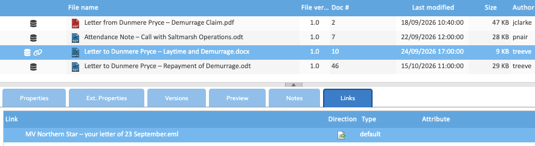

A link ties two documents together, such as a letter and the email that answers it, so that whoever opens one can
find the other. Both documents show it, and a document with links shows a chain icon in the documents list.

## Making a Link

1. Right-click the first document and choose **Copy**. Select several first to link them all.
2. Right-click the other document and choose **Paste as link**.

You need the Write permission on the document you paste onto. **Paste as link** is greyed out until you've copied a
document.

## The Links Tab

Select a document and open its **Links** tab to see its links.

| Column | What it shows |
|---|---|
| Link | the other document's file name |
| Direction | an arrow showing which way the link was made |
| Type | the link's type, `default` for a link made with Paste as link |

Double-click a link to download the other document, or to preview it if your administrator has set double-clicks to
preview. Right-click it for:

- **Preview** and **Download,** for the other document;
- **Download package,** a zip of this document and every document linked to it;
- **Open in Folder,** which opens the other document's folder with it selected;
- **Delete,** which removes the link, never either document.

## Removing a Link

Right-click the link on the **Links** tab, choose **Delete** and confirm. You need the Delete permission on the other
document's folder.

## Links and Copies

Copying a document with **Copy links** ticked gives the copy the same links. See
[Copying, Moving and Deleting](../copying-moving-and-deleting/#copying-a-document).

A link doesn't put a document in a second matter, and doesn't share it with anyone: each document keeps its own folder
and permissions, and opening the other document still needs permission to read it.
