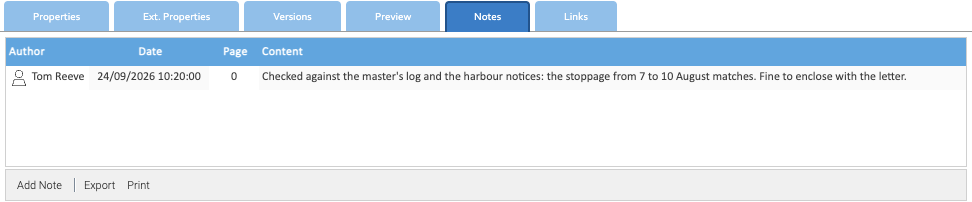

A note is a comment kept with a document in Healdan, not in its file: a check you've made, a point for whoever picks it
up next. Notes never change the file.

## The Notes Tab

Select a document and open its **Notes** tab.

Each note shows its author, its date, a page number (0 for a note on the whole document) and its text. **Export** and
**Print** at the bottom save or print the list.

## Adding a Note

1. Choose **Add Note** at the bottom of the **Notes** tab.
2. Type the note. The toolbar above the text sets its font, size, alignment and style.
3. Choose **Save**.

You need the Write permission on the document. Adding a note is recorded in its
[history](../document-history/), as "Added new note", and changes its Last modified date. It doesn't count as working
in the matter, so it doesn't put the matter in your
[Recent Matters](../../finding-documents/my-matters-and-recent-matters/).

## Editing, Printing and Deleting

Right-click a note for **Edit**, **Print** and **Delete**.

## Who Sees a Note

A note starts with its document's permissions:

- **Everyone who can read the document** can read its notes.
- **People who can edit the document** can usually edit and delete its notes too, not only their author.
- **Its author and administrators** always can.

A note's own **Security**, on its right-click menu, can narrow who sees it, if you have the Security permission on
the note.

## Searching Notes

The search box at the top doesn't look in notes. To find a document by its notes, open the **Search** tab's
**Full-text** section, add **Notes** to **Search in**, type the words in **Expression** and search.

## Copies

Copying a document with **Copy notes and annotations** ticked copies its notes too. See
[Copying, Moving and Deleting](../copying-moving-and-deleting/#copying-a-document).

## Annotations

LogicalDOC's annotations, notes pinned to a place on a page, aren't part of Healdan. A Word document's own comments
and tracked changes show in its [preview](../previews/#tracked-changes-and-comments).
