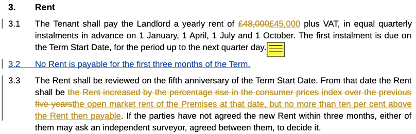

A preview is a quick check that a document is the one you expect, before you open, print or email it. PDFs and pictures
preview in the browser, and so do Word, Excel, PowerPoint and OpenDocument files, LibreOffice Draw's drawings among
them, which Healdan turns into PDFs. All of them get thumbnails.

## Quick Look

Select a document in any list, a folder, search results or Recent Documents, and press **Space**. A large preview opens
over the page, as Finder's Quick Look does. Nothing behind it moves.

- **The bar across the top** has **‹** and **›**, the document's name, its place in the list (**4 of 7**), its doc #
  (**# 10388**), a button that docks the preview (see [The Reading Pane](#the-reading-pane)), and **Open** and
  **Download**.
- **Move through the list** with ‹ and ›, or the arrow keys, except while the page itself has the focus (see below). The row behind Quick Look moves with you, so when you
  close it, you're on the document you ended on. Past the last document loaded, › loads the next page of the list.
- **Close it** with Space or **Esc**. The focus goes back to the row.
- **Other ways in:** the **Preview** button in the toolbar above the list, and the one on the thumbnail in the
  document's details.

A PDF is shown one page at a time, with **Previous Page** and **Next Page**, and **Zoom In** and **Zoom Out**, in steps
from 50% to 300% of the width of the room. 100% fits the page to it. To scroll a page that's bigger than the room with the
keyboard, Tab to the page: while it has the focus, the arrow keys scroll it, as they do any scrollable area, and Page
Up and Page Down scroll it too. Move the focus off it, to the bar or the dialog, and the arrow keys walk the list again.
Holding Space down doesn't open and close Quick Look over and over.

## The Reading Pane

**Open as Reading Pane** in Quick Look's bar docks the preview in the right region, where the details usually are.

- **It stays while you click or arrow down the list,** previewing each document you select, until you close it with
  **Close Preview**. Closing it brings the details back.
- **The funnel still opens Filters in its place.** The reading pane comes back when you next click a row, or close
  Filters.
- **The list keeps Title, Doc # and Edit Date** while the pane is open, so it fits beside it. The other columns come
  back when you close it.
- **With no document selected,** the pane waits for you to select one.

## What's Shown

| Kind | How it's shown |
|---|---|
| PDF | Its own pages |
| Word, Excel, PowerPoint, OpenDocument and drawings | The PDF Healdan makes of them (see below) |
| Pictures | As themselves, the file's own bytes. A picture your browser can't draw, such as a TIFF in Chrome, says there's no preview |
| Emails | As a message: who sent it, to whom and when, its attachments and its text (see [Reading an Email](../../working-with-matters/emails/#reading-an-email)) |
| Anything else | "There's no preview for this kind of file.", with **Open** and **Download** |

A preview needs the Preview permission on top of reading the document, for a picture as for a PDF, and previewing is
never recorded as a download. A document protected by a password has no preview in the new interface. Without the
permission, you see the same words as for a type with no preview.

## Which Files Preview

| Kind | Files | How they look |
|---|---|---|
| Word | `doc`, `docx`, `docm`, `dot`, `dotx`, `dotm`, `rtf` | pages as they'd print |
| Excel | `xls`, `xlsx`, `xlsm`, `xlt`, `xltx`, `xltm`, `csv` | every visible sheet, using its print settings. A wide sheet without them is split across pages |
| PowerPoint | `ppt`, `pptx`, `pptm`, `pps`, `ppsx`, `pot`, `potx` | one slide per page, without speaker notes |
| OpenDocument | `odt`, `ott`, `ods`, `ots`, `odp`, `otp` | as their Word, Excel or PowerPoint kind |
| Drawing | `odg` | one page of the drawing per page |

The layout is recognisably the document, but not always identical to Office's.

## Tracked Changes and Comments

A preview shows the markup a document still carries, so you can catch a draft that isn't clean before it goes out.

- **Tracked changes** show as redlines, even if the document was saved with markup hidden. This works for `docx`,
  `docm`, `dotx` and `dotm` files. Older formats show markup only if they were saved showing it.
- **Comments** show as a note icon at the commented text. The preview doesn't open the note: to read a comment, open
  the document.
- **Thumbnails** show the markup too.

## When It's Ready

Healdan prepares previews in the background when a file is filed or a new version is saved, usually within a minute.
If you open one before that, the page says **Preparing a preview…** and asks again every few seconds, as the server
tells it to, so the page appears by itself.

## "Not Available"

A file that can't be converted, such as a damaged or password-protected one, has no preview, and the page says so,
with Open and Download. It doesn't hold up anyone else's previews. If a file you expect to preview doesn't, tell your
administrator.

If the files' storage can't be reached for the moment, a banner says so, and the preview offers **Try Again**.

## Printing

The preview doesn't print. To print a document, download it, or open it in the Classic Interface, whose preview has a
print button, and print from there.
