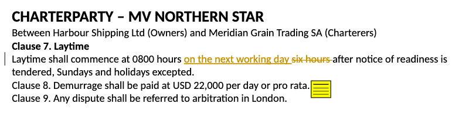

A preview is a quick check that a document is the one you expect, before you open, print or email it. Word, Excel,
PowerPoint and OpenDocument files preview in the browser and get thumbnails, as PDFs and images do.

## Which Files Preview

| Kind | Files | How they look |
|---|---|---|
| Word | `doc`, `docx`, `docm`, `dot`, `dotx`, `dotm`, `rtf` | pages as they'd print |
| Excel | `xls`, `xlsx`, `xlsm`, `xlt`, `xltx`, `xltm`, `csv` | every visible sheet, using its print settings. A wide sheet without them is split across pages |
| PowerPoint | `ppt`, `pptx`, `pptm`, `pps`, `ppsx`, `pot`, `potx` | one slide per page, without speaker notes |
| OpenDocument | `odt`, `ott`, `ods`, `ots`, `odp`, `otp` | as their Word, Excel or PowerPoint kind |

The layout is recognisably the document, but not always identical to Office's.

## Tracked Changes and Comments

A preview shows the markup a document still carries, so you can catch a draft that isn't clean before it goes out.

- **Tracked changes** show as redlines, even if the document was saved with markup hidden. This works for `docx`,
  `docm`, `dotx` and `dotm` files. Older formats show markup only if they were saved showing it.
- **Comments** show as notes: an icon at the commented text, which shows the comment when you click it.
- **Thumbnails** show the markup too.

## When It's Ready

Healdan prepares previews in the background when a file is filed or a new version is saved, usually within a
minute. If you open a preview before that, wait a moment: it's made on the spot.

## Printing and Downloading

- **Print** from the preview, if you have the Print permission.
- **The preview's download button** saves it as a PDF, if you have the Download permission.
- **Without Download,** you see the thumbnail, but the preview says "not available", as it does for PDFs.

## "Not Available"

The preview says "not available" for a file that can't be converted, such as a damaged or password-protected one.
It doesn't hold up anyone else's previews. If a file you expect to preview doesn't, tell your administrator.
