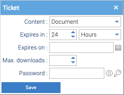

A **ticket** is a link that downloads one document without signing in to Healdan, for as long as you allow.


**A ticket only works for someone who can reach your Healdan server.** Healdan is meant to be reachable only on your
firm's network or over its VPN, so a client or anyone else outside the firm usually can't open the link. Inside it,
anyone who has the link can download the document until the ticket ends, without signing in: treat the link like
the document itself.


To point a colleague at a document, you don't need a ticket: send them the **Details** link beside **Permalink** on
the document's **Properties** tab. They sign in to open it, and see it only if they're allowed to.

## Making a Ticket

Right-click the document and choose **More → Ticket**. You need the Download permission on it.



| Field | What it does |
|---|---|
| Content | **Document** for the file as it is, or **PDF Conversion** for a PDF of it |
| Expires in | how long the link works: a number of **Hours** or **Days**, 24 hours to begin with |
| Expires on | a date the link stops working, instead |
| Max. downloads | how many downloads the link allows. Leave it empty for no limit |
| Password | a password the link asks for. The key beside it suggests one |

Choose **Save**. Healdan makes the ticket and records "A ticket has been created" in the document's
[history](../document-history/).


**Healdan doesn't show a ticket's link yet.** After **Save**, the Ticket window that should show the link stays
empty. Close it, and ask your administrator for the link.


## Opening the Link

The link downloads the document straight away. With a password, the browser first asks for a user name and a
password: the user name can be anything, and the password is the ticket's.

Each download counts towards **Max. downloads**, and is in the document's history as "The document has been
downloaded". Once the ticket has expired or its downloads are used up, the link stops working.

## For Administrators

**Administration → Reports → Tickets** lists every ticket: its ID, its downloads against their limit, whether it has
a password, when it was made and by whom, when it expires, and its document. Right-click a ticket to **Disable** or
**Enable** it, **Delete** it, **Set password** or **Unset password**, or **Open in Folder** to find its document.

A ticket's link is your Healdan address, then `/download-ticket?ticketId=`, then the ticket's ID: for a server at
`https://healdan.example`,

```text
https://healdan.example/download-ticket?ticketId=2db7a511-61f2-44d4-bd9f-6573677110a5
```

To stop a link before it expires, disable or delete its ticket.
