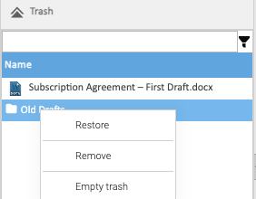

A document or folder you delete goes to the trash, where you can restore it until it's removed for good.

## Finding It

Open the **Trash** section at the bottom of the Documents screen's left pane. It lists what **you** deleted, by
name: others' deletions are in their own trash. Type in the box above the list to filter it.

## Restoring

Healdan restores into the folder that's **open in the folder tree**, which isn't always where the item was. So:

1. In the **Browser** section, open the folder to restore into: usually the one it was deleted from.
2. Open the **Trash** section, right-click the document or folder, and choose **Restore**.

Healdan says "Document restored into the current folder", or "Folder restored into the current folder".

- **The usual rule applies.** A document can only be restored into a folder inside a matter's workspace. Restored
  at the top level of a matter, it's refused with "Documents can't be saved at the top level of a matter. Choose one
  of its folders."
- **You need the Delete permission** on what you restore, as you did to delete it. Restoring a document into another
  folder than the one it came from also needs the Write permission there, and a folder the Add permission.
- **If right-clicking does nothing,** the open folder is one you can't add to. Open another first.
- **A restored document keeps its doc #.**
- **Restoring a folder brings back what was deleted inside it,** even documents deleted before the folder itself.

## Removing for Good

- **Remove,** on an item's right-click menu, takes it out of the trash for good, after you confirm. You can't restore
  it afterwards.
- **Empty trash** removes everything in your trash.

Your administrator can see what everyone has deleted, under **Administration → Reports**.
