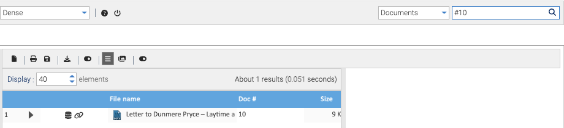

Every document in Healdan has a **doc #**: a whole number that's unique across all Stores. It's given when the
document is filed and never changes, through every version, move and rename. A deleted document's number is never
given to another.

## Going Straight to a Document

With the search box's scope on **Documents**, type the doc # with a `#` in front and press Enter:

| Type | Finds |
|---|---|
| `#1234` | document 1234, at its current version |
| `#1234.2` or `#1234v2` | version 2 as it stands: its latest snapshot |
| `#1234.2.1`, `#1234v2.1` or `#1234 v2.1` | exactly snapshot 2.1 |

A space after the `#` is fine, and so is one before the `v`. `#1234 v2.1` is the doc ID: the form the title bar
shows in LibreOffice (`Lease agreement #1234 v2.1`) and the [doc ID footer](../../office/doc-id-footer/) prints, so you
can copy it from either. The Healdan Helper's Save and Open windows take the same forms.

- **For `#1234`,** the Search tab lists just that document, ready to open, preview, download, or to look at its
  properties and versions.
- **For a version or snapshot,** a window titled "#1234 version 2.1" shows when that version was saved and by whom,
  with **Preview** and **Download** buttons. See [Versions](../../documents/versions/).

- **It's found the moment it's filed.** Doc # lookups don't wait for the search index.
- **If you can't read the document,** Healdan answers as if it didn't exist: "No document #1234". A version that
  doesn't exist answers "Document #1234 has no version 2.1".
- **Without the `#`,** `1234` is an ordinary full-text search, because numbers appear inside documents too.

## Legacy Doc \#

A document moved in from another document management system keeps its old number as its **Legacy doc #**
property. Healdan still gives it a doc # of its own, and `#` searches only doc #s, never legacy ones.
