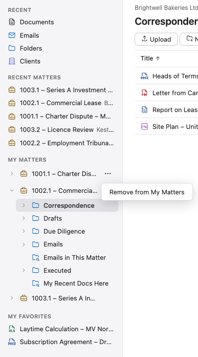

The left pane has two lists of matters, so the matters you use most are a click away. If your firm calls matters
something else, such as projects, the headings use its word.

## My Matters

Your own list of matters, as a tree. Open a matter with its arrow to see its folders and search folders, and open a
folder to see its own folders. A search folder has its own icon, a folder with a magnifying glass. Click a row to
open it in the main area.

- **The tree opens to where you are.** When the folder open in the main area is inside one of your matters, the tree
  opens the folders above it and marks its row.
- **Rename a folder** with its **⋯** button, shown while you point at it or move to it with the arrow keys, or with
  **F2**. See [Renaming a Folder in the App](../../documents/copying-moving-and-deleting/#renaming-a-folder-in-the-app).
- **To add a matter,** open it, or any folder in it, and click **+** beside the **My Matters** heading. The **+**
  shows only while you're in a matter that isn't in the list yet. Or right-click the matter in **Recent Matters**, or in
  a search for matters, and choose **Add to My Matters**.
- **To take a matter off,** point at it in the tree, click the **⋯** at the end of its row, and choose **Remove from
  My Matters**, or right-click it and choose the same. From the keyboard, move to the matter's row and press the
  right arrow: the first press opens the matter, the next moves to **⋯**, and Enter opens its menu; or press
  Shift-F10 on the row. See [Right-Click Menus](../../getting-started/getting-around/#right-click-menus).

My Matters are kept as bookmarks, so a matter you add also shows in the Classic Interface's **Bookmarks** section,
and removing that bookmark there removes it from My Matters.

## Recent

At the top of the left pane, **Recent** has four entries. Each opens a list of what you worked on lately, newest first,
and sets the scope picker beside the search box to its scope, so your next search looks there.

| Entry | Lists |
|---|---|
| **Documents** | the documents you filed, changed, checked in or out, or downloaded in the last 30 days, up to 50, with each one's matter. It's the page you start on |
| **Emails** | the same, but only emails (`.eml` and `.msg` files), up to 50 of them |
| **Folders** | the folders in matters where you filed or changed a document in the last 30 days, with each one's matter, up to 20 |
| **Clients** | the clients of your Recent Matters and My Matters, by name and number |

Healdan has no list of all clients: a client shows here only through a matter you can read.

- **Click a document** to select it, and its **Details** open at the right, with **Location**. Its doc # goes into the
  page's address. Press Enter or double-click on a document to open it in its app, as in a folder (see
  [Opening Documents](../../office/opening-documents/#from-the-app-open)); it's selected too.
- **Rename, move and delete** work here as in any list: the toolbar's **More** (⋯) has **Rename**, **Move To…** and
  **Delete**, F2 renames and Delete asks before moving to the Trash. See
  [Copying, Moving and Deleting](../../documents/copying-moving-and-deleting/).
- **Open a folder** with a click or Enter: it opens as it does anywhere.
- **Open a client** and Healdan searches the **Clients** scope for it, which lists that client's matters.
- **The lists keep the server's order,** so no column header sorts them. Your administrator can change the 30 days.

## Recent Matters

The matters where you filed or changed a document in the last 30 days, newest first, up to 20. Your administrator
can change the 30 days. A matter leaves the list once you haven't worked in it for that long.

## In Both Lists

- **Each entry** shows the matter, then its client's name in smaller text: `1002.1 – Commercial Lease Brightwell
  Bakeries Ltd`. An entry that's too long for the pane is cut off at its end.
- **Click an entry** to open the matter's top level in the main area: its folders, its search folders and any
  documents an administrator put there. See
  [Stores and Matter Workspaces](../../working-with-matters/stores-and-matter-workspaces/#opening-a-matter).
- **A matter you can no longer open,** or one that's been deleted, doesn't appear.
