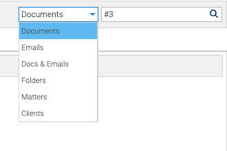

The search box is at the top right of the screen. The scope picker beside it says what to search: **Documents**
unless you change it. It remembers your choice until you close the browser.

## Scopes

| Scope | Type | Finds |
|---|---|---|
| Documents | `#1234` | that document. See [Finding a Document by Doc #](../finding-by-doc-number/) |
| Documents | words | documents containing them, without emails |
| Emails | words | emails containing them |
| Docs & Emails | words | documents and emails containing them |
| Folders | words | folders whose names contain them |
| Matters | a matter number such as `998.1`, or words | the matter with that number, opened straight away; or the matters whose name or description contains the words |
| Clients | a client number or words | the matters of every client whose number or name matches |

Your install may call matters *projects*. The Matters scope then uses that word.

## Full-Text Search

Full-text search finds words inside documents, including Word, Excel and PowerPoint files, PDFs, and emails' text
and attachment names. A document is searchable shortly after it's filed.

## Matter Numbers

- **`998.1`** opens matter 1 of client 998.
- **A bare number,** such as `1`, depends on how your install numbers matters. If each client numbers its own
  matters, it lists every matter numbered 1, or opens it if there's only one. If matter numbers are unique across the
  system, it opens that matter.
- **Matter results show their client's name,** so two clients' "Leases" matters can be told apart.

## Results

Results open in the **Search** tab. A document result has the same menu and details as anywhere else: its
properties, versions, history, security and preview. Double-click a matter result to open it.

You only ever see what you're allowed to read.
