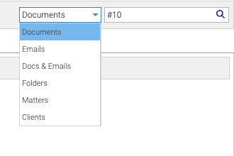

The search box is at the top right of the screen. The scope picker beside it says what to search: **Documents**
unless you change it. It remembers your choice until you close the browser.

## Scopes

| Scope | Type | Finds |
|---|---|---|
| Documents | `#1234` | that document. See [Finding a Document by Doc #](../finding-by-doc-number/) |
| Documents | words | documents containing them, or whose Comments contain them all, without emails |
| Emails | words | emails containing them |
| Docs & Emails | words | documents and emails containing them |
| Folders | words | folders whose names contain them |
| Matters | a matter number such as `998.1`, or words | the matter with that number, opened straight away; or the matters whose name or description contains the words |
| Clients | a client number or words | the matters of every client whose number or name matches |

Your install may call matters *projects*. The Matters scope then uses that word.

## Full-Text Search

Full-text search finds words inside documents, including Word, Excel and PowerPoint files, PDFs, and emails' text
and attachment names. A document is searchable shortly after it's filed.

An email's From, To, CC and Subject are part of its text, so words in them are found. Its Message-ID isn't, so the
search box doesn't find it. To find an email by its Message-ID, open the **Search** tab's **Full-text** section,
choose **Healdan profile** as the **Template**, add **Message-ID** to **Search in**, and type the whole Message-ID in
**Expression**, exactly as its properties show it.

## Matter Numbers

- **`998.1`** opens matter 1 of client 998.
- **A bare number,** such as `1`, depends on how your install numbers matters. If each client numbers its own
  matters, it lists every matter numbered 1, or opens it if there's only one. If matter numbers are unique across the
  system, it opens that matter.
- **Matter results show their client's name,** so two clients' "Leases" matters can be told apart.

## Results

Results open in the **Search** tab. A document result has the same menu and details as anywhere else: its
properties, versions, history, security and preview. Double-click a matter result to open it.

You only ever see what you're allowed to read.

## Filters

In Healdan's app, **Filters** narrow the documents a folder lists. Press the **Filters** button, a funnel at the right
end of the list's toolbar, and the filters open at the right of the list. Press the button again, or **Close
Filters** in the panel, to put them away.

| Filter | Options |
|---|---|
| **Edit Date** | Any Time, Today, Last 7 Days, Last 30 Days, This Year, or Between… with a **From** day and a **To** day (either can be left empty; an end date before the start date isn't applied, and the field says so) |
| **File Type** | Word, Excel, PowerPoint, PDF, Email, OpenDocument, Picture, Other |
| **Author** | the people who are an Author of documents in the folder |
| **Class** | the classes of documents in the folder |

Today and the date ranges follow the server's time zone.

- **Each option shows a count:** how many documents ticking it would leave, among those you can read that pass the
  other filters. Options that would leave none aren't listed, apart from any you've already ticked.
- **Ticking several options in one list** keeps documents that match any of them, such as Word or PDF. Filters of
  different lists apply together, such as Word or PDF *and* by Priya Nair.
- **Chips** above the list name every filter in use, such as "File Type: Word, PDF", each with a **×** that drops it,
  and **Clear All** drops them all. A filter that no option in the panel offers any more still has its chip, so a
  filter can never leave a document out of sight without saying so.
- **The button's badge** counts the filters in use, even while the panel is closed. The count above the list then
  reads "3 of 7 documents": the documents that pass, of all the folder's documents you can read.
- **Filters list documents, not folders,** so a folder's own folders are left out while a filter is in use.
- **Clicking a document** while the filters are open puts the panel away to make room for that document's own
  panel. The filters stay set, and the button brings the panel back.
- **The filters are in the page's address,** so Back, bookmarks and a copied link keep them.
