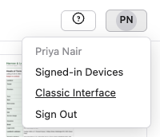

Healdan's web page has a top bar across the top, a left pane down the left side and the main area beside it. The
colours follow your browser's light or dark setting.

Each kind of item has its own icon, drawn in its kind's colour: a matter's briefcase is amber, a client's building
indigo and a folder blue, and among documents, word-processing documents are blue, spreadsheets green, presentations
orange-red, PDFs red, emails blue and pictures purple. Some kinds share a blue, so the icon's shape tells them apart.
LibreOffice's text documents, spreadsheets and presentations take the colours of their Microsoft Office counterparts,
and any other kind of file, such as a drawing, has the plain document icon in the colour of the text beside it.

![Healdan's web page in the Due Diligence folder of matter 1002.1 – Commercial Lease: the top bar with the Healdan name, the Documents search box, the ? button and the PN menu; the left pane with Recent, Recent Matters, My Matters opened to the matter's folders, and My Favorites; the folder's two documents, Service Charge Budget 2026–27.xlsx and Site Plan – Unit 4 Weir Lane.odg, with the second selected; and its details at the right, with the thumbnail of the plan, its name with the Favorites star beside it, Open, Download, Copy Link and Check Out, then the Properties and Versions (1) tabs, with Properties showing Edit Properties and the plan's properties](whole-window.png)

## The Top Bar

- **Healdan's mark and name** on the left take you back to the start page.
- **The search box,** with the scope picker joined to its left. Press `/` to jump to it. It suggests matters and
  documents as you type, and `#` and a doc # goes straight to that document. See [Searching](../../finding-documents/searching/).
- **The ? (Help) button** opens a menu with **User Guide** and **Open-Source Notices**, the notices for the open-source
  software Healdan uses; each opens in a new window.
- **Your menu**, under your initials, shows your name and has Signed-in Devices, Classic Interface and Sign Out.
  Signed-in Devices lists where your account is signed in besides this page, and ends any of them: see
  [Signed-in Devices](../signed-in-devices/). Classic Interface opens the older web page, on the same sign-in. Sign Out
  ends your session.

## The Left Pane

The left pane scrolls on its own when it's longer than the window. From the top it has:

- **Recent:** **Documents**, **Emails**, **Folders** and **Clients**, each a list of what you worked on lately. Each
  also sets the scope the search box searches in. **Documents** is the page you start on.
- **Recent Matters:** the matters you've worked in lately, each with its client beside it in smaller, paler type.
- **My Matters:** the matters you've chosen to keep at hand, as a tree. Open a matter to see its folders and search
  folders, and open a folder to see its own folders. A search folder has its own icon. The tree opens to the folder
  you're in, and **+** beside the heading adds the matter you're in.
- **My Favorites:** documents and folders you've added as favourites, each with the icon of its kind, as in the
  lists. The star beside a folder's name, or beside a document's name in its details, adds one.

[My Matters and Recent Matters](../../finding-documents/my-matters-and-recent-matters/) explains the first two.
If your firm calls matters something else, such as projects, the headings use its word: Recent Projects and My
Projects.

## The Main Area

When you sign in, the main area shows **Recent Documents**: the documents you filed, changed, checked in or out, or
downloaded lately, newest first, as a list with each one's matter. A pencil at the end of a document's title means it's
checked out, and a padlock that it's locked: point at it to see who has it (see
[In the Lists](../../documents/checking-out-and-checking-in/#in-the-lists)). Click one to select it. Its doc # goes into the
page's address, so the link you copy takes someone to the same place, and Back and Reload keep it. See
[Recent](../../finding-documents/my-matters-and-recent-matters/#recent).

Open a matter or a folder from the left pane, and the main area lists what's in it: see [Opening a
Matter](../../working-with-matters/stores-and-matter-workspaces/#opening-a-matter).

## The Details Panel

Select a document in a folder's list, in search results or in a Recent list, and its **Details** open at the right, in the same place as
[Filters](../../finding-documents/searching/#filters). At the top, whichever tab is showing, they have:

- **A thumbnail** of the first page, when the document has one. Without one, the icon for the kind of file shows
  instead.
- **The name,** with a star beside it that adds the document to **My Favorites** and takes it off again, and under it
  the doc #, the version and the size: `# 10388 · Version 2 · 209 KB`.
- **Open** opens the document in its app through the Healdan Helper, or downloads it when the helper doesn't open that kind
  of file: see [Opening Documents](../../office/opening-documents/#from-the-app-open). **Download** saves a copy of its file: see
  [Downloading Documents](../../documents/downloading-documents/#one-document-in-the-app). **Copy Link**
  puts the document's address on your clipboard: see [Copying a Link](../../finding-documents/finding-by-doc-number/#copying-a-link).
- **Check-Out Info** or **Lock Info,** in a shaded box, while someone has the document checked out or locked: who has
  it and since when. Then **Check Out** and, once it's checked out to you, **Check In** and **Release**: see
  [Checking Out and Checking In](../../documents/checking-out-and-checking-in/#in-the-app).

Under them are two tabs, **Properties** and **Versions**:

- **Properties:** Client, Matter, Class, Subclass, Author, Typist and Date Filed, and, for an email, From, To, Sent
  and Received. In search results, Recent lists and a document's own page (`/app/doc/` and its doc #) there is also
  **Location**, the document's folder, which you can click. Choose **Edit Properties**, at the top of the tab, to
  change the ones you can, such as Class, Subclass, Author and Typist: see
  [Properties](../../working-with-matters/properties/#editing-in-the-app).
- **Versions,** with how many there are in brackets: the document's timeline, newest first, with who saved each and
  when.

The arrow keys move between the tabs once one has the keyboard's focus. Click another document to see its details
instead, on the same tab, or select several and the details close. The details start on **Properties** each time you
open or reload the web page.

## Resizing the Panes

The left pane, and the details, Filters or preview at the right, can each be made wider or narrower. Point at the line
between a pane and the list: the pointer becomes a resize arrow and the line darkens. Drag it to where you want it,
with the mouse, a finger or a pen. The list takes whatever room the panes leave, and its columns follow.

From the keyboard, Tab to the divider, which a screen reader names **Resize Navigation**, **Resize Details**, **Resize
Filters** or **Resize Preview** and reads its width in pixels. Then:

| Key | What it does |
|---|---|
| Left and right arrows | Move the divider 16 pixels; with Shift, 64 |
| Home and End | Make the pane as narrow, or as wide, as it goes |
| Enter | Puts the pane back to its usual width |

Double-clicking the divider puts the pane back to its usual width too.

- **The left pane** goes from 180 to 420 pixels wide. It starts at 248.
- **The details and Filters** share one width, from 260 pixels to half the window. They start at 300.
- **The preview,** once docked, keeps a width of its own, as a page needs more room than the details do. Until you
  change it, it takes a share of the window.
- **The list keeps at least 481 pixels,** so on a smaller window the panes can't be made as wide.

Healdan remembers each width in this browser, so the panes are as you left them next time, but not in another browser
or on another computer. A width that doesn't fit a smaller window is drawn as wide as fits, and comes back when the
window is wide enough again.

## Keeping Up to Date

The web page brings what it shows up to date each time you come back to it: when you click back into its window from
another app, such as Word or Excel, or switch back to its tab. So a document you opened in Excel shows as checked out
to you, with the pencil in the list, and each save you make there shows as a new version, without reloading the page. Search results are the
exception: they stay as they were until you search again. A search folder, and a list you've scrolled past its first
100 documents, are brought up to date on coming back only once what they show is over 30 seconds old, or after you
open a document in an app from the page, as each update runs the search again, or asks for every 100 documents.

## Right-Click Menus

Right-click a document, a folder or a matter, in a list or in the left pane, for a menu of what you can do with it. On
a Mac, Control-click does the same. Every choice in these menus is also on the toolbar or beside the item, so the menu
is a shortcut, never the only way.

- **A document,** in a folder, search results, **Recent Documents**, **Recent Emails** or a doc # result: **Open**,
  **Preview** and **Open in New Tab**; **Download** and **Check Out**, or **Check In** and **Release** when you checked
  it out on the web page; **Rename**, **Move To…** and **Delete**; **Copy Link** and **Add to Favorites** (or **Remove
  from Favorites**). They work as the toolbar's buttons and its **⋯** (More) menu do.
- **A folder,** in a list or in the **My Matters** tree: **Open**, **Open in New Tab**, **New Folder** where you can
  make one (inside a matter, and never in a search folder), and **Add to Favorites** or **Remove from Favorites**.
- **A matter,** in **My Matters**, **Recent Matters** or a search for matters: **Open**, **Open in New Tab**, and
  **Add to My Matters** or **Remove from My Matters**.
- **An item in My Favorites:** **Open**, **Open in New Tab** and **Remove from Favorites**.

Right-clicking a document that isn't selected selects it first, in place of what was selected, as the Finder does.
Right-clicking one of several selected documents keeps them all selected, and the menu then acts on all of them: only
**Move To…** and **Delete** take several documents, so the rest are greyed out, as they are on the toolbar.

**Open in New Tab** opens the document's or folder's page in a new browser tab. Anywhere else, such as a text box, the
search box, an email's message, a preview, or the space in a list below its last row, right-clicking shows your
browser's own menu, so copy, paste and spelling work as usual.

With the keyboard, press Shift-F10, or the menu key if your keyboard has one, to open the menu of the row, tree item or
link in **Recent Matters** or **My Favorites** that has the focus. The arrow keys move through the menu, Enter chooses, and Esc closes it and puts the focus back where
it was.

## The Keyboard

In the left pane's tree, the up and down arrow keys move between rows, the right arrow opens a matter or folder, the
left arrow closes it, and Enter opens the row. In a folder's list, the up and down arrow keys move the selection, and
Enter opens a folder. Esc closes a menu.

Everything in the app can be done from the keyboard: Tab moves between the parts of the page, and these keys work
once the list has the focus.

| Key | What it does |
|---|---|
| `/` | Jumps to the search box |
| Up and down arrows | Move through the list |
| Enter | Opens the document in its app (the Healdan Helper), or a folder |
| Space | Opens Quick Look; Esc closes it |
| F2 | Renames the selected document in place |
| Delete | Moves the selected documents to the Trash, after asking |
| Shift-F10, or the menu key | Opens the [right-click menu](#right-click-menus) of the row, tree item or left-pane link with the focus; Esc closes it |
| Option-Enter on **Upload** | Files with the form first |

## A Narrower Window

On a window narrower than 1,024 pixels, such as a tablet, the left pane and the details, Filters or preview fold away
so the list has the room. Two buttons in the top bar, the **☰** (Navigation) button and the panel-icon (Details and
Filters) button, open them over the list, and Esc or choosing a link closes them again. They open at their usual
widths and can't be resized there; the widths you chose come back when the window is wider again. A phone's screen is
too small for the app.

## When Something Goes Wrong

- **"You've been signed out."** Your session lapsed, or you signed out in another tab. **Sign In** brings you back
  to the page you were on.
- **"Not found, or you can't see it."** The page, folder or document doesn't exist, or you don't have permission to
  read it. Healdan says the same for both.
- **"You don't have permission to do that."** You can see the document or folder, but not do what you asked to it, such
  as delete or move it. Ask your administrator for the permission.
- **"Files are unavailable for now. Try again in a few minutes."** Healdan can't reach where your files are kept.
  Your work isn't lost. Ask your administrator if it lasts.
- **"Something went wrong."** Try Again asks once more. If it keeps failing, tell your administrator.
