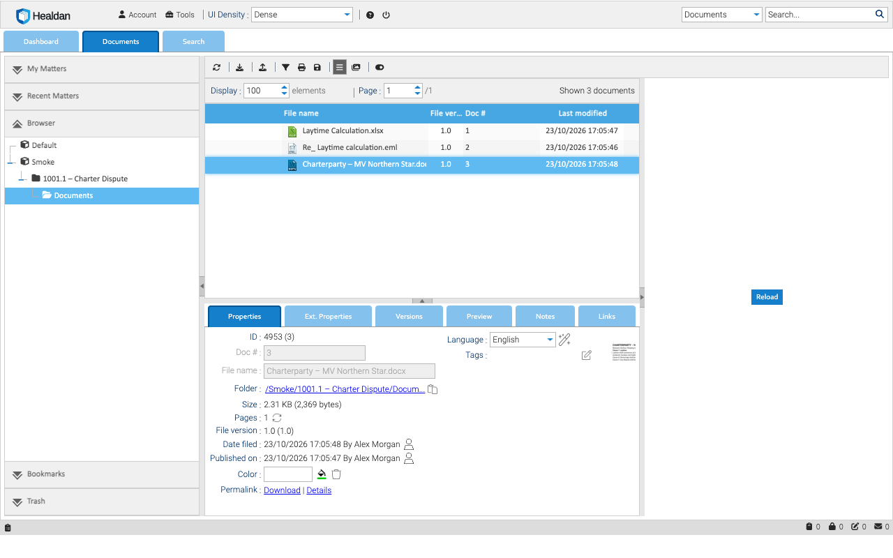

## The Top Bar

- **Account** has your profile and password. **Tools** has a few utilities.
- **The help icon** opens the documentation, and **the power icon** signs you out.
- **The search box** is on the right, with its scope picker beside it. See [Searching](../../finding-documents/searching/).

## The Tabs

- **Dashboard:** the documents you have checked out or locked, and your tags and messages.
- **Documents:** the matters and their documents. You'll spend most of your time here.
- **Search:** the results of a search, and a form for more detailed searches.

Administrators also see an **Administration** tab.

## The Documents Tab

**The left pane** has five sections. One is open at a time: click a section's title to open it.

- **My Matters:** the matters you've chosen to keep at hand.
- **Recent Matters:** the matters you've worked in lately.
- **Browser:** the folder tree, with the Stores you can see at the top and their matters inside them.
- **Bookmarks:** documents and folders you've bookmarked.
- **Trash:** things you've deleted, until they're emptied.

[My Matters and Recent Matters](../../finding-documents/my-matters-and-recent-matters/) explains the first two.

**The list** in the middle shows the open folder's documents, with each one's file name, version, doc # and when it
was last changed. The toolbar above it has the upload button, among others.

**The details** under the list show the selected document:

| Tab | What it shows |
|---|---|
| Properties | its doc #, file name, folder, size, version, Date filed, and a thumbnail |
| Ext. Properties | its client, matter, Author, Class and the rest of its [properties](../../working-with-matters/properties/) |
| Versions | its [versions and snapshots](../../documents/versions/) |
| Preview | a [preview](../../documents/previews/) of the document |
| Notes, Links | notes on the document, and links to other documents |

More tabs appear when you have the permissions for them, such as Security.

**The right-hand panel** shows a preview of the selected document too.
