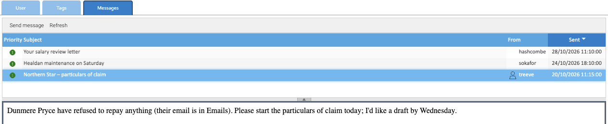

Messages are short notes between people who use Healdan, such as a partner asking for a draft or the office manager
warning of downtime. They stay inside Healdan: they aren't emails.

## Reading Messages

The envelope at the right of the status bar, at the bottom of the screen, shows how many messages you haven't read.
Open the **Dashboard** tab, then its **Messages** tab.

The list shows each message's priority, subject, sender and when it was sent, the newest first. Click a message to
read it in the panel below. Reading it marks it read, and **Refresh** brings the list and the unread count up to
date.

## Sending a Message

1. On the **Messages** tab, choose **Send message**.
2. Under **Recipients**, choose people from **Users**, or a whole group from **Groups**. Each one you choose is
   listed above them.
3. Type a **Subject** and the **Message**.
4. Choose **Submit**.

The other settings are optional:

- **Confirmation:** tick it to be told when each recipient reads the message. You get a message called
  "Confirmation" for each.
- **Validity:** how many days the message is meant to last, 1 to begin with.
- **Priority:** low, medium or high. It shows as the icon in the list.

There's no reply button: to answer a message, send one back to its sender.

## Deleting a Message

Right-click it and choose **Delete**. Messages stay in your list until you delete them, whatever their validity.

## Messages from Healdan

Healdan sends messages of its own too. For example, if your administrator chose you for them, you're told when a
username or address is blocked after too many wrong passwords.
