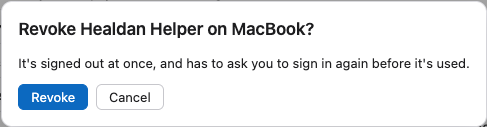

Healdan Helper signs in to Healdan with a sign-in of its own on each Mac, which you don't type a password for. The
Office add-ins and the LibreOffice extension don't sign in: they work through the helper. A program of your own that
signs in through Healdan's API with your password is listed too. **Signed-in Devices** lists them, so you can see where your account is
signed in and end any sign-in you don't want.

## Opening the List

Open your menu, under your initials in the top bar, and choose **Signed-in Devices**. The list is yours alone: nobody
else's sign-ins show in it, and nobody else sees yours.

## What's Listed

Each row is one device, with:

- **Device:** its name, such as "Healdan Helper on" the Mac's name;
- **Signed In:** when it signed in;
- **Last Used:** when Healdan last heard from it, to within a few minutes;
- **Expires:** when the sign-in ends of itself.

A sign-in ends of itself when it goes unused for 30 days, and a year after it began at most. Your administrator can
change both. It also ends when you change your password. See [Installing the Healdan
Helper](../../office/installing-the-helper/#the-sign-in-window).

## What Isn't Listed

This web page's own sign-in isn't in the list. It isn't a device: it lives in your browser, and **Sign Out** in the
same menu ends it. The Classic Interface shares that sign-in, so **Sign Out** there ends both pages.

## Revoking a Device

Revoke ends one device's sign-in at once.

1. Choose **Revoke** beside the device. Healdan asks first, naming it, such as "Revoke Healdan Helper on
   MacBook?", so a slip doesn't end the wrong one.
2. Choose **Revoke** again to confirm, or **Cancel** to leave it as it was.

Healdan says "Revoked" and the device's name, and the device leaves the list. Close the list with **Close** or Esc.

### What the Device Does Next

The device finds out the next time it asks Healdan for anything. Healdan Helper then says "Sign in to Healdan again.
Your saves wait on this computer until you do", and its Sign In window says "Your sign-in ended. Sign in again."
Anything you saved meanwhile waits on the Mac, and the documents you had open stay checked out to you. See [Signed Out
or Signed In Again](../../office/when-things-go-wrong/#signed-out-or-signed-in-again).

Healdan doesn't tell the device why, so the window doesn't say it was revoked. Sign it in again whenever you're ready.
Revoking doesn't change your password, and doesn't sign you out of this page.

If you lose a Mac or leave it signed in somewhere you shouldn't have, revoke its row, and change your password if you
want every device out: a new password ends all of them.

## If Something Goes Wrong

- **"Not found, or you can't see it."** The device was gone already, perhaps ended by its own **Sign Out** a moment
  ago. Close the list and open it again.
- **"Something went wrong."** **Try Again** asks for the list once more. If it keeps failing, tell your administrator.
