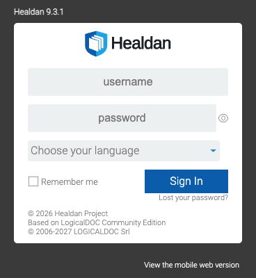

Open the address your administrator gave you, and sign in with your user name and password.


Healdan's interface today is LogicalDOC's, changed only as much as Healdan needs: its name and logo, the doc #,
matters and the search box. So some screens still look like LogicalDOC's. A new Healdan interface comes later.


## Your First Sign-In

Your administrator sets your user name and a first password. Change the password once you're in, from your
profile: see [Your Profile and Password](../your-profile-and-password/).

- **Remember me** keeps you signed in on this browser. Leave it unticked on a computer others use.
- **Choose your language** sets the language of Healdan's screens.

## Signing Out

Use the power icon in the top bar, next to the help icon.

## If You Can't Sign In

- **"The application has to be restarted"** on the sign-in page means the server needs a restart. Tell your
  administrator.
- **A page that looks out of date** after Healdan was upgraded usually means your browser kept the old one. See
  [Clearing Your Browser's Cache](../clearing-your-browsers-cache/).
- **A forgotten password:** **Lost your password?** under the Sign In button resets it by email, if your install
  can send email. Otherwise your administrator can reset it.
