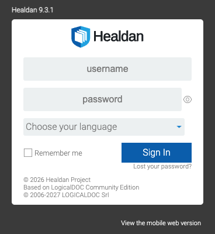
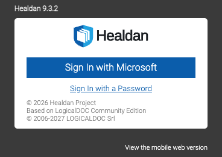

Open the address your administrator gave you. If your firm signs people in through a provider, such as Microsoft,
the page shows its button: see [Signing In Through a Provider](#signing-in-through-a-provider). Otherwise, sign in
with your user name and password.


Healdan's interface today is LogicalDOC's, changed only as much as Healdan needs: its name and logo, the doc #,
matters and the search box. So some screens still look like LogicalDOC's. A new Healdan interface comes later.


## Your First Sign-In

Your administrator sets your user name and a first password. Change the password once you're in, from your
profile: see [Your Profile and Password](../your-profile-and-password/). If you sign in through a provider
instead, there's no first password: your administrator tells you which button to choose.

- **Remember me** saves your user name and password in this browser, and fills them in next time. Leave it unticked
  on a computer others use.
- **Choose your language** sets the language of Healdan's screens. These docs describe them in English. In other
  languages, some of Healdan's labels, such as Doc # and Date filed, still show LogicalDOC's wording.

## Signing In Through a Provider

A sign-in provider is a service your firm already uses to sign people in, such as Microsoft Entra ID. When your
administrator has set one up, the sign-in page shows a button for each, above the password form:

1. Choose the button, such as **Sign In with Microsoft**. Your administrator chooses what each one says.
2. Sign in at the provider, as you do there for anything else. Healdan never sees your password.
3. The provider sends you back, and Healdan opens.

The first time, Healdan either finds your account or makes one for you, and puts you in the groups your
administrator has matched to yours at the provider. You don't set a password. An account that signs in through a
provider has none, so **Change password** and **Lost your password?** don't apply to it.

### The Password Form

The password form is folded away behind a link under the buttons, **Sign In with a Password** unless your
administrator has worded it otherwise. Choose it, and the form appears as it is on a page without a provider, with
Remember me, the language picker and **Lost your password?**.

Use it for an account that doesn't sign in through the provider, such as `admin`. An account that does can't sign
in with a password.

### When a Provider Sign-In Is Refused

Healdan sends you back to the sign-in page with a message above the buttons. It names your provider as "your
sign-in provider", whichever one you chose.

| The page says | What it means | What to do |
|---|---|---|
| Your account at your sign-in provider doesn't give you access to Healdan. Ask an administrator. | The provider signed you in, but none of your groups there gives you a place in Healdan. | Ask an administrator for access to Healdan. |
| Healdan can't tell which account is yours. Ask an administrator. | Your email address at the provider matches an account Healdan can't link you to: more than one account, one that's already linked to someone, or `admin`. | Ask an administrator. |
| Healdan already has an account with your username. Ask an administrator. | Healdan can't make you an account, as one with your username already exists. | Ask an administrator. |
| This account can't sign in now. Ask an administrator. | Healdan refused your account: it's disabled, has expired, or is outside the hours it may sign in. | Ask an administrator. |
| Your sign-in provider couldn't sign you in. Try again, or ask an administrator. | The provider couldn't be reached, turned you down, or sent an answer Healdan didn't accept. | Choose the button again. If it keeps happening, ask an administrator. |
| That sign-in took too long or was already used. Start again. | You took more than 10 minutes at the provider, or went back to a sign-in that had already finished. | Choose the button again. |

## Signing Out

Use the power icon in the top bar, next to the help icon. It brings you back to the sign-in page, and nothing signs
you straight back in.

If you signed in through a provider, signing out of Healdan doesn't sign you out of the provider. On a computer
others use, sign out of the provider too: the next person to choose the button may be signed in as you.

## If You Can't Sign In

- **"The application has to be restarted"** on the sign-in page means the server needs a restart. Tell your
  administrator.
- **A page that looks out of date** after Healdan was upgraded usually means your browser kept the old one. See
  [Clearing Your Browser's Cache](../clearing-your-browsers-cache/).
- **A forgotten password:** **Lost your password?** under the Sign In button resets it by email, if your install
  can send email. Otherwise your administrator can reset it.
- **"Your username is temporarily blocked. Try after 15 minutes."** After five wrong passwords in a row, Healdan
  refuses that username for 15 minutes, even with the right password, wherever you sign in. Wait, then sign in
  again. Your account isn't disabled, and trying again while you wait doesn't make the wait longer. If the wrong
  passwords weren't yours, tell your administrator.
- **"Your IP is temporarily blocked. Try after 15 minutes."** Twenty failed sign-ins in a row from your network
  address block it for 15 minutes, for everyone signing in from it. Wait, then sign in again. If it keeps
  happening, tell your administrator.
