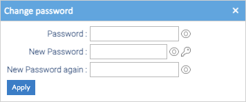

Everything about your own account is under **Account** in the top bar:

- **Profile:** your details, how Healdan looks for you, and your email signature;
- **Security:** **Change password**, **Last Logins**, **Allowed Impersonators** and **API Keys**;
- **Contacts:** your address book, for sending documents by email;
- **Remove cookies:** resets what this browser remembers for Healdan;
- **Logout:** signs you out.

## Your Profile

**Account → Profile** has four tabs. Change what you need, then choose **Save** at the top.

| Tab | What it holds |
|---|---|
| Details | your name, the language of Healdan's screens, your address and phone numbers, company and department, and your time zone |
| User Interface | the tab you start on (**Welcome screen**), the Store the Documents tab opens at (**Workspace**, LogicalDOC's word for it), and your column layouts and date formats |
| Email | the email address Healdan writes to you at, and the signature for documents you send by email |
| Secondary Email | another address, if you have one |

Your username can't be changed here. Ask your administrator.

## Changing Your Password

1. Choose **Account → Security → Change password**.
2. Type your current **Password**, then the **New Password**, and the **New Password again**.
3. Choose **Apply**.

The key beside **New Password** opens a **Password Generator**, which suggests a password that meets the rules.
**Generate** makes another one.

### The Rules

Healdan starts with these rules. Your administrator can change them, and the window says which one a password
breaks.

- At least 8 characters, with at least 2 upper case letters, 2 lower case letters, a digit and a symbol.
- No run of 5 or more characters in sequence, such as `abcde`, `12345` or `qwert`, and no character more than 3
  times.
- Not one of your last 3 passwords.

Your administrator can also set your password to expire. Healdan then asks for a new one when you sign in 90 days
after you last changed it.

### Five Wrong Passwords

Five wrong passwords in a row block your username for 15 minutes, wherever you sign in: the web page, the
[Healdan Helper](../../office/) and the rest. See
[Signing In](../signing-in/#if-you-cant-sign-in).

## Last Logins

**Account → Security → Last Logins** lists when you signed in, from which network address and with which browser.
If you see a sign-in that wasn't you, change your password and tell your administrator.

## Allowed Impersonators

**Account → Security → Allowed Impersonators** lists the people allowed to sign in with their own password but act in
your name, such as an assistant working on your behalf. They sign in as `theirname>yourname`, and what they do then
is done as you. Leave the list empty unless your firm works that way.

## API Keys

**Account → Security → API Keys** makes keys that let a program use LogicalDOC's web services as you. Healdan's own
programs don't need them: the [Healdan Helper](../../office/installing-the-helper/) signs in with your password once
and keeps a sign-in of its own. Make a key only if your administrator asks you to.

A key keeps working after you change your password. To stop one, right-click it and choose **Delete**.
