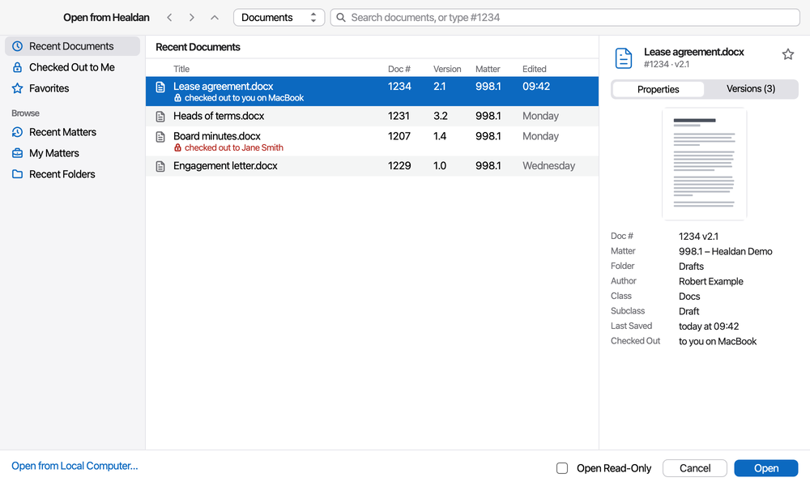

<!-- The pictures of the helper's windows on this page are renders of its real windows, drawn offscreen with test
data, not screenshots. Replace them with screenshots during the owner's acceptance (M3 plan, Task 21). -->

You can open a Healdan document in LibreOffice from the web page, or from inside LibreOffice. Either way, a document
you can edit opens checked out to you, and one you can't opens as a read-only copy.

## From the Web Page: Open in App

Select one document, then choose **Open in App** on the toolbar, or right-click it and choose **Open in App**. The
document opens in LibreOffice, and the helper's menu lists it.

- **It's on** for one document at a time, of a kind LibreOffice edits: `.doc`, `.docx`, `.docm`, `.dotx`, `.dotm`,
  `.rtf`, `.odt`, `.ott`, `.xls`, `.xlsx`, `.xlsm`, `.ods`, `.ppt`, `.pptx`, `.pptm` and `.odp`. You need permission
  to download it. The helper opens only these kinds from the web page: a link to any other file is refused, with a
  notice (see [Other Kinds of File](#other-kinds-of-file)).
- **It's on while the document is checked out** too, so you can reopen your own, and others get a read-only copy.
- **The first time,** your browser asks whether this page may open Healdan Helper. Allow it, and tick the box to
  remember, if there is one.
- **A notice appears** in the web page: "If nothing opened, install the Healdan Helper", with a link to
  [Installing the Healdan Helper](../installing-the-helper/). If the document did open, ignore it.
- **Use one address.** The helper opens only documents from the server it's signed in to, so open the web page at
  the address you signed the helper in with. If you sign in to the helper as `docs.example.org`, a web page opened
  as `192.168.1.20:8080` has its links refused, with a notice saying why.

Double-clicking a document in the web page still shows its preview.

## From LibreOffice: Open from Healdan

Any of LibreOffice's ways of opening shows the **Open from Healdan** window: **⌘O**, **File › Open**, **Open File**
in the Start Center, and **Healdan › Open from Healdan…**. So does **Open from Healdan…** in the helper's menu.

- **On the left:** Recent Documents (where it starts), Checked Out to Me and Favorites, then Recent Matters, My
  Matters and Recent Folders to browse.
- **In the middle:** each document's title, doc #, version, matter, and when it was last saved. Under the title,
  who has it checked out: "checked out to you on MacBook", or "checked out to Jane Smith".
- **On the right:** a small preview of the first page ("No preview yet" until Healdan has made one), the main
  properties, and the versions. The star adds the document to your Favorites, or takes it off.
- **To find a document,** type in the search box: it searches documents, unless you choose another scope beside it.
  `#1234` and Enter shows document 1234, and `#1234 v2.1` selects that version.
- **To open it,** double-click it, or select it and choose **Open**.

At the bottom:

- **Open Read-Only:** tick it, then choose **Open**, for a copy you can read but not save to Healdan, even if you
  could edit it.
- **An older version** always opens read-only: choose it in the versions list.
- **Open from Local Computer** shows LibreOffice's own Open box, for a file on your Mac.

## What Happens When It Opens

If you can edit the document and nobody else has it checked out, the helper checks it out to you on this Mac,
downloads it and opens it. The title bar shows its doc # and version: `Lease agreement #1234 v2.1`. Each save goes
to Healdan, and closing checks it back in: see [Editing and Versions](../editing-and-versions/).

A document you already have open comes to the front instead of opening twice, and clicking Open in App twice opens
it once.

## Read-Only Copies

A document opens as a read-only copy when:

- someone else has it checked out, or it's locked in the web page;
- you may read it but not edit it;
- you ticked Open Read-Only, or chose an older version.

Its title ends in "(read-only)", and a notice says why, such as "Opened read-only: Jane Smith has it checked out."
LibreOffice opens it read-only. Nothing you do to it reaches the document: saving it shows Save as New Document
instead, which files your changes as a new document (see
[Editing and Versions](../editing-and-versions/#save-as-new-document)). The copy is deleted when you close it.

## Checked Out to You on Another Computer

If you have the document checked out on another of your computers, the helper asks first:

- **Open Read-Only** opens a read-only copy here, and leaves the check-out where it is.
- **Edit Here Instead** moves the check-out to this computer and opens the document for editing. What you saved on
  the other computer since its last save to Healdan isn't in it. The other computer keeps its copy, but its next save
  or close is refused: see [When Things Go Wrong](../when-things-go-wrong/#your-check-out-ended).
- **Cancel** does nothing.

A document checked out in the web page isn't held on any computer, so it opens for editing on whichever you use.

## Other Kinds of File

A PDF, an image or any other file LibreOffice doesn't edit opens read-only in your Mac's usual app for it, from the
Open from Healdan window. It isn't checked out.

- **Only from Open from Healdan.** Open in App, and any other link, opens only documents, spreadsheets and
  presentations. A link to another kind of file says "… wasn't opened: a link opens only documents, spreadsheets and
  presentations". Open it from the Open from Healdan window, or download it from the web page.
- **Your Mac checks it.** The helper marks the copy as downloaded from the internet, so macOS checks it as it would
  any download.
- **Never apps, installers or scripts.** A file that can run a program or change your Mac when opened, such as
  `.app`, `.command`, `.pkg`, `.dmg`, `.sh` or `.mobileconfig`, isn't downloaded or opened: the helper says it never
  opens that kind of file. If you need it, download it from the web page.

## What Can't Be Opened

- **A password-protected document.** Open it in the web page.
- **Anything while Healdan can't be reached.** Opening always needs the server; only saves can wait for it.
