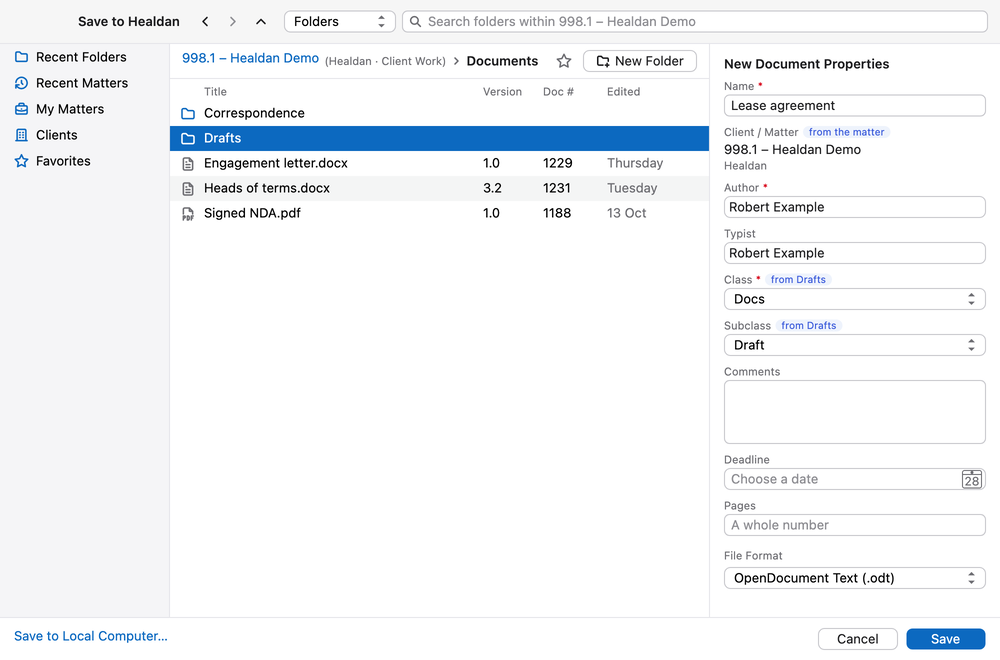

<!-- The picture of the Save to Healdan window is a render of the helper's real window, drawn offscreen with test
data, not a screenshot. Replace it with a screenshot during the owner's acceptance (M3 plan, Task 21). -->

A new document goes into Healdan the first time you save it, through the **Save to Healdan** window. It works the
same in Writer, Calc and Impress.

## Opening the Window

On a document that isn't in Healdan yet, any of these opens Save to Healdan:

- **Save** (**⌘S**), or **File › Save As**;
- **Healdan › Save to Healdan…**, or **Save to Healdan** on the Healdan toolbar;
- **Save** when LibreOffice asks whether to save your changes as you close the document.

## Choosing a Folder

The window starts on **Recent Folders**. Choose where the document goes from the left:

| Place | What it lists |
|---|---|
| Recent Folders | the folders you've filed in or worked in lately |
| Recent Matters | the matters you've worked in lately |
| My Matters | your own list of matters, as in the web page |
| Clients | nothing by itself: it sets the search to Clients, so you can type a client's number or name |
| Favorites | your favourite folders: see [Favourites](#favourites) |

- **Matters** are listed with their client's name after them, in smaller type: `998.1 – Healdan Demo (Healdan)`.
- **Double-click a matter or a folder** to go into it. The bar above the list shows where you are, from the matter
  down, with the matter's client and Store after it: `998.1 – Healdan Demo (Healdan · Client Work) › Documents`.
  Click any part of it to go back there. The arrows at the top go back, forward and up.
- **Click a folder in the list** to file into it, or leave nothing selected to file into the folder shown.
- **Save turns on** once you've chosen a folder that can hold documents, inside a matter, and every required
  property has a value. A Store, a matter's top folder and a search folder can't hold documents, as in the web page.

### Searching

The picker beside the search box chooses what to search for: **Folders**, **Documents**, **Matters** or **Clients**.
Inside a matter, Folders and Documents search only that matter: the box says so, as in "Search folders within 998.1
– Healdan Demo". Type and press Enter.

- **A matter number** such as `998.1`, with Matters chosen, finds that matter.
- **`#1234`** and Enter goes to the folder of document 1234, with the document selected.

### New Folder

**New Folder** makes a folder inside the folder shown. Type its name, then **Create** or Enter. It's selected, ready
to file into.

- It takes its properties and permissions from the folder it's in, like a folder made in the web page.
- You need permission to add to that folder. Only administrators can add a folder at a matter's top level.

### Favourites

The star beside the bar adds the folder shown to your **Favorites**, or takes it off. Your favourites are the same as
your bookmarks in the web page, apart from your matters, which are My Matters. See
[Bookmarks](../../documents/bookmarks/).

## The Properties

The right of the window holds the new document's properties, mostly filled in from the folder you chose. Required
ones are marked with a red star.

- **Name:** the document's name. It starts from the name LibreOffice gave it, or the file's name if it was saved on
  your Mac before. Healdan adds the extension.
- **Client / Matter,** marked "from the matter", shows the matter, with its client's name under it. It can't be
  changed.
- **Author** and **Typist** are you, unless you change them. Type part of a name to find someone else.
- **Class** and **Subclass** follow the folder. A chip such as "from Drafts" says where the value comes from.
  Choosing another Class narrows the Subclass list to its own.
- **Comments:** anything you want to note about the document, up to 4000 characters. A search of the Documents
  scope finds the document by any word in it, here and in the web page.
- **Any other property** your administrator added. A date is a calendar date: pick it from the calendar.

See [Properties](../../working-with-matters/properties/) for what each one holds.

## The Format

Below the properties, choose the file format. The app's own comes first, and is chosen until you change it:

| App | Its own format | The other |
|---|---|---|
| Writer | OpenDocument Text (`.odt`) | Word Document (`.docx`) |
| Calc | OpenDocument Spreadsheet (`.ods`) | Excel Workbook (`.xlsx`) |
| Impress | OpenDocument Presentation (`.odp`) | PowerPoint Presentation (`.pptx`) |

Choose with care: a document keeps the format it was filed in for life. To have it in the other format later, save it
as a new document (see [Editing and Versions](../editing-and-versions/#save-as-new-document)).

## After You Save

LibreOffice's status bar says "Saving to Healdan…" for a moment, then the title bar shows the document's doc # and
version: `Lease agreement #1235 v1.0`.

- **It's still open, and checked out to you.** The window is now Healdan's local copy of it, and each save from now
  on goes to Healdan: see [Editing and Versions](../editing-and-versions/).
- **It's filed in Healdan at once,** with its doc #, so others can find it, and it's in your Recent Documents.

## Saving to Your Mac Instead

**Save to Local Computer**, at the bottom left, shows LibreOffice's own Save As box instead. A document saved there
isn't in Healdan. Choose **Healdan › Save to Healdan…** whenever you want to file it.

## If It Doesn't Work

- **"… couldn't be filed in Healdan"** gives Healdan's reason, such as a required property or a name that isn't
  allowed. The document is still open: save it again.
- **Healdan can't be reached,** so the filing fails. Save again once it can: a new document needs Healdan to get its
  doc #.
- **The helper isn't running,** so LibreOffice shows its own Save As box, and says so. Start Healdan Helper from your
  Applications folder.

More in [When Things Go Wrong](../when-things-go-wrong/).
