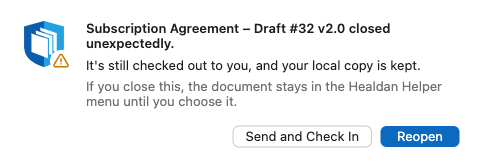

The helper's first rule is that nothing you save is lost. When something goes wrong, it keeps your work on your Mac
and tells you, through a notification or, when it needs an answer, a window of its own.

## Healdan Can't Be Reached

You're offline, or the server is down, when you save.

- **Your save is safe.** LibreOffice saves to your Mac as usual, and the document stays checked out to you.
- **The helper keeps trying.** A notice says "A save is waiting for Healdan", and the helper's menu shows how many
  saves are waiting.
- **When Healdan is back,** the helper sends them, in order, and says "Your saves have reached Healdan." The title
  bar moves on to your last save, however long Healdan was away.
- **Restarting is safe.** If your Mac restarts first, the helper finds the waiting saves when it starts again and
  sends them.

Opening a document needs Healdan, so that has to wait.

## The Helper Isn't Running

You quit it, or haven't signed in since your Mac started.

- **LibreOffice's Open and Save** show LibreOffice's own boxes, with a notice that the helper isn't running.
- **In Word, Excel and PowerPoint,** a Healdan button opens a Healdan window that says so (see
  [What the Healdan Window Says](#what-the-healdan-window-says)). Office's own Open and Save work as ever, and a save
  on a Healdan document goes to the copy on your Mac, as below.
- **A save on a Healdan document** is still kept on your Mac, and goes to Healdan once the helper is running again.
  The title bar then moves on to your last save, however long the helper was away.
- **The notice goes by itself** once LibreOffice hears from the helper again, such as when your kept save reaches
  Healdan, or when you next use a Healdan command.

Start **Healdan Helper** from your Applications folder.

## What the Healdan Window Says

When a button on the Healdan tab can't do what you asked, or has something to tell you, a small Healdan window opens
over the document with the reason. Close it when you've read it. It's the same for Word, Excel and PowerPoint.

| It says | What to do |
|---|---|
| This app isn't paired with Healdan Helper yet | Type the code the helper shows, and choose **Pair**: see [Pairing Again](#pairing-again) |
| Healdan Helper isn't running, or Microsoft Office isn't set up in it | Start **Healdan Helper** from your Applications folder, and sign in. If its menu offers **Set Up Microsoft Office…**, choose it: see [Setting Up Microsoft Office](../installing-the-helper/#setting-up-microsoft-office) |
| Healdan Helper is signed out, or still starting up | Choose **Sign In…** in the helper's menu, or wait a moment, then press the button again |
| Healdan Helper works with a different Healdan server than this one | The helper is signed in to another server than the one that deployed the add-in. Sign it in to this server: see [Settings](../installing-the-helper/#settings) |
| This add-in needs a newer Healdan Helper | Install the newer disk image over the old one, as your administrator tells you |
| Healdan Helper finished, but its answer was lost | Check the document in Healdan, by its doc # or its matter, before pressing the button again: it may already have been filed |
| Healdan Helper couldn't find the document you pressed that in | Click in the document, then press the button again |
| This document isn't open from Healdan, so there's no version to add to | Use **Save to Healdan** to file it first |
| This is a read-only copy, so it can't be saved as a new version | Use **Save as New Document** instead |
| Microsoft Office didn't do what the add-in asked | Try again. If it keeps happening, tell your administrator what the brackets say |
| Use Word's own Save As to save it on this computer, or Use Word's own Open to open a file on this computer | You chose **Save to Local Computer** or **Open from Local Computer** in the helper's window: use the app's own Save As or Open for that. It names Excel or PowerPoint when you're in them |
| Healdan's buttons work in the desktop apps only | You're in Word, Excel or PowerPoint on the web. Use the desktop apps on your Mac |

## The Healdan Tab Is Missing

- **It hasn't arrived yet.** Microsoft delivers an add-in to each person's apps in its own time, which can be hours
  after your administrator deployed it. Check again later.
- **You aren't signed in to Office** with your organisation's Microsoft 365 account. The add-in comes with that account.
- **Your administrator didn't give it to you.** They can add you in Microsoft 365's admin centre: see
  [Deploying the Add-in](../../../install/office-integration/#deploying-the-add-in).
- **The tab is greyed out** in a window holding an OpenDocument file, such as `.odt`. Office turns Healdan's add-in off
  for those. Open the document in LibreOffice, where the Healdan menu works for it.

## A Button Seems to Do Nothing

The helper may have a window open that you can't see, such as Save to Healdan, Open from Healdan or Properties, behind
your other windows. The button waits for as long as that window is open. Look for it behind the app, or in Mission
Control, and finish or cancel it. Word, Excel and PowerPoint may also be showing a prompt for access to the helper's `Copies`
folder: see [The First Save in Each App](../saving-to-healdan/#the-first-save-in-each-app).

## Pairing Again

An app asks for a new code when it has lost its pairing: Office's cache was cleared, or you chose **Forget** for the
app in the helper's Settings. Press a Healdan button, and type the code as the first time: see
[Pairing Word, Excel and PowerPoint](../installing-the-helper/#pairing-word-excel-and-powerpoint).

- **Wrong codes are counted.** Three wrong tries cancel a code, and nine wrong codes in a row make the helper stop
  showing codes for ten minutes.
- **Another person's helper on the same Mac** may answer instead of yours: see
  [Known Limitations](../../../install/known-limitations/).

## LibreOffice or Your Mac Crashes

The document stays checked out to you, and your local copy is kept as you last saved it. Within about ten seconds of
LibreOffice going, or as soon as the helper starts after your Mac restarts, this window opens:

- **Reopen** opens your kept copy, with what you last saved, and carries on as before.
- **Send and Check In** sends what Healdan hasn't had yet, and checks the document in.
- **Closing the window** decides nothing: the document stays in the helper's menu, marked "(closed unexpectedly)",
  until you choose it, which reopens it. The helper's icon in the menu bar shows a dot until you choose the
  document.

A read-only copy has nothing to lose: the window says so, and offers **Remove Copy**.

## Word, Excel or PowerPoint Crashes

The same window opens when Word, Excel or PowerPoint goes away with a Healdan document open: the document stays
checked out to you, and your local copy is kept as you last saved it.

Word keeps more than that. When it starts again, it reopens the document by itself, with what you'd typed since your
last save, as "… - Recovered". Its own Save would ask where to save it, as Word treats a recovered document as one
that was never saved. You don't need to:

- **The helper saves it back by itself,** over your local copy, once Word has it open again, and sends it to Healdan
  as your next save. The crash window then goes by itself, the title moves on, and you carry on as before.
- **Until then, Reopen,** in the crash window, starts Word, which brings the recovered document back, and the helper
  saves it in the same way.
- **Until then, Send and Check In** sends what you last saved, and checks the document in. Once the document is open
  again, the helper doesn't check it in under its open window: close the window, and that checks it in.

If Excel or PowerPoint brings a document back by itself in the same way, the helper saves it back too.

## Your Check-Out Ended

While you had the document open, its check-out ended:

- it was checked in or unlocked in the web page, by you or an administrator;
- you chose **Edit Here Instead** for it on another of your computers.

Your next save, or closing the window, is then refused, so it can't land on a document that's moved on. A notice says
"It can't be saved to Healdan any more. Your copy is kept: use Save as New Document to file your changes."

- **While it's open:** choose **Healdan › Save as New Document…** to file your changes as a new document.
- **If you've closed it:** the helper's menu lists it under **Not Yet in Healdan**. Choose it there to open your kept
  copy as it is, with no check-out, then choose Save as New Document. Opening the document again from Healdan opens
  the kept copy too, rather than downloading over it.

The copy stays on your Mac, and in that list, until you've filed it or its changes have reached Healdan.

## Someone Changed It in the Web Page

Anyone who may edit a document can change its properties or rename it in the web page while you have it open. Your
next save then starts from a version Healdan has moved past.

- **If only the properties or the name changed,** the helper sends your save again on top of them, by itself.
- **If someone stored newer content,** your save isn't sent over it. Your copy is kept, and you're told to use Save as
  New Document.

## Signed Out or Signed In Again

When your sign-in stops working (you changed your password, or the helper wasn't used for a long time), the helper
says "Sign in to Healdan again. Your saves wait on this computer until you do", and shows the Sign In window. The
documents you have open stay checked out to this Mac.

The helper also shows the Sign In window, once, when the sign-in in your keychain wasn't made for it: the first time
an updated helper starts, if the sign-in is from a version that didn't record which copy of the helper it belongs to,
or after the helper's files were deleted from your Mac. It never uses such a sign-in, as Healdan would then take this
Mac's check-outs for another computer's, and it signs it out.

## A Link Didn't Open

When Open in App doesn't open anything:

- **Nothing at all happened:** the helper isn't installed, or your browser didn't hand the link over. See
  [Installing the Healdan Helper](../installing-the-helper/).
- **Nothing happened, and there's more than one copy of Healdan Helper on your Mac,** such as an old one left in
  Downloads: macOS may hand the link to a copy that isn't the one running. A current copy passes the link on to the
  running helper, but an old one can't. Keep only the copy in Applications.
- **"That link is from …, but Healdan Helper is signed in to …":** open the web page at the address the helper is
  signed in to: **Open Healdan in Browser** in the helper's menu opens it. See
  [Opening Documents](../opening-documents/#from-the-web-page-open-in-app).
- **"Sign in to Healdan Helper to open documents":** you're signed out. Choose **Sign In…** in the helper's menu,
  then click Open in App again.
- **One of the helper's windows is waiting for you,** such as Save to Healdan. The helper ignores links meanwhile,
  and brings that window to the front: finish with it, then click Open in App again.
- **"#1234 is still being checked in":** you closed it moments ago. Open it again once the check-in is done.
- **"… wasn't opened: a link opens only documents, spreadsheets, presentations and drawings":** the link was to a PDF
  or another kind of file. Open it from **Open from Healdan…**, or download it from the web page. See
  [Other Kinds of File](../opening-documents/#other-kinds-of-file).

## Asking for Help

The helper's log is `~/Library/Logs/Healdan Helper/helper.log`, and the LibreOffice extension's is `extension.log`
beside it. They hold no passwords and no document contents, so you can send them to your administrator.
