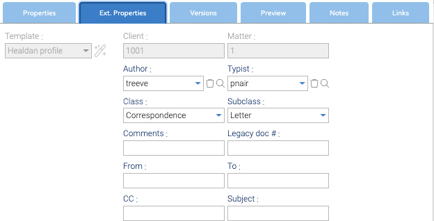

Every document and folder carries the same set of properties, the **Healdan profile**. Select a document and open
its **Ext. Properties** tab to see them. Its **Properties** tab shows the doc #, which can't be edited, and the Date
filed.

## The Properties

| Property | What it holds |
|---|---|
| Client | the client's number. Always the matter's; can't be changed |
| Matter | the matter's number. Always the matter's; can't be changed |
| Author | who the document is by. You, unless you change it |
| Typist | who filed it, for filing on someone else's behalf. You, unless you change it |
| Class | the kind of document, from a list your administrator keeps. Required; "Docs" unless something sets another |
| Subclass | a finer kind, from the chosen Class's list. Optional |
| Comments | anything worth noting about the document, up to 4000 characters. Optional |
| Legacy doc # | the document's number in the system it came from, if it was moved in from one |
| From, To, CC, Subject, Sent, Received | an email's details. See [Emails](../emails/) |

Your administrator can add more properties.

## Comments

Comments is free text for anything worth noting about a document: what it is, who it's for, what's still to do.

- **It's searchable.** The search box's **Documents** scope finds a document whose Comments contain every word you
  type, in any case, as well as the documents containing them. `lease renewal` finds one whose Comments say "Draft
  renewal of the lease".
- **From LibreOffice,** the [Healdan Helper](../../office/)'s Save to Healdan window asks for Comments as you file a
  document.

## Properties Pass Down

Client, matter, Class, Subclass and any properties your administrator adds pass down from a folder to the folders
and documents inside it. A document filed in a folder whose Class is Invoices is an Invoice, without anyone setting
it. Author, Typist, Comments, Legacy doc # and the email details belong to one document and don't pass down.

## Overriding a Property

To give a document or folder a value of its own, set it on that document or folder. It then stops following its
folder for that property, and passes its own value down if it's a folder.

- **To follow the folder again,** set the property back to the value it would inherit, or clear it.
- **Client and Matter can't be overridden.** They always come from the matter.
- **Changing the Class** clears a Subclass that doesn't belong to the new Class.
